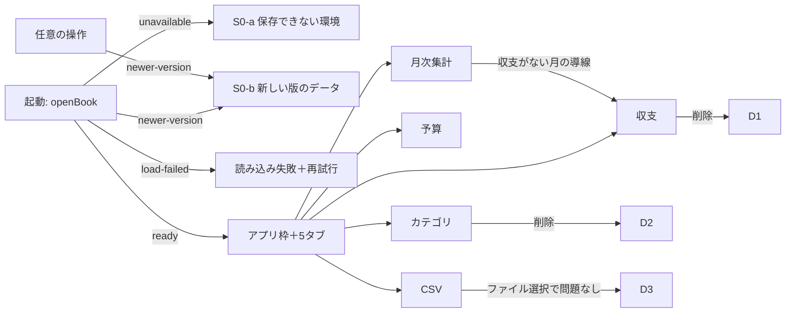

# 機能仕様（app-screens）

- 出典: `entities.md`、`rules.md`、`inception/refined-mockups/mockups.md`、`inception/refined-mockups/interaction-spec.md`、`inception/user-stories/stories.md`（US1.1〜US9.3、95件）、`inception/contract-design/contract-summary.md`（C1〜C6）、`functional-design-questions.md`（Q1 = A）

## 1. 担当するストーリーと受け入れ条件

| ストーリー | 規則 |
|------------|------|
| US1.1 どの画面でも同じ規則で入力が検証される | BR1.1 |
| US1.2 入力したデータが次に開いたときも残っている（表示の側） | BR1.2、BR1.5、BR1.6 |
| US1.3 自分のデータが外部へ送られない | BR1.3 |
| US2.1〜US2.5 収支の登録・一覧・編集・削除 | BR2.1〜BR2.5、BR8.1〜BR8.3 |
| US3.1〜US3.4 カテゴリ | BR3.1〜BR3.5、BR8.3 |
| US4.1〜US4.3 予算 | BR4.1〜BR4.3、BR8.3 |
| US5.1〜US5.4 月次集計 | BR5.1〜BR5.4、BR1.4 |
| US6.1〜US6.3 CSV 書き出し | BR6.1〜BR6.3 |
| US7.1〜US7.4 CSV 取り込み | BR7.1〜BR7.5 |
| US8.1〜US8.4 状態の表示 | BR8.1〜BR8.4、BR1.2 |
| US9.1〜US9.3 キーボードとフォーカス | BR9.1〜BR9.3 |

受け入れ条件 95 件はすべて上の規則に対応づける（traceability.json）。業務の計算と検証の本体は U1〜U6 にあり、U7 はそれを表示し操作を渡す。

## 2. 起動と画面の切り替え

テキストでの説明: 起動時に一度だけ openBook を呼ぶ。結果で S0-a・S0-b・再試行・アプリ枠のどれかを表示する。アプリ枠の中で任意の操作が newer-version を返したら、S0-b に切り替えて以後の操作を止める（BR1.6）。

## 3. 画面ごとの流れ（要点）

| 画面 | 読み取り（U4・U5・U6） | 操作と渡し先 | 主な表示 |
|------|------------------------|--------------|----------|
| S1 収支 | listTransactions(month)、listCategories() | addTransaction、updateTransaction、deleteTransaction | 登録フォーム、月の一覧、D1 |
| S2 月次集計 | getMonthlySummary(month) | なし（表示のみ） | 3つの合計、支出の行、収入の行、案内 |
| S3 予算 | getEffectiveBudgets(month) | setBudget、clearBudget | 支出カテゴリの予算の行 |
| S4 カテゴリ | listCategories()、getCategoryUsage() | addCategory、renameCategory、deleteCategory | 支出と収入の一覧、D2 |
| S5 CSV | なし（書き出しは exportTransactions） | exportTransactions、parseImportFile、commitImport | 書き出し、ファイル選択、D3 |

## 4. 失敗と知らせの扱い（全画面共通）

| 結果 | 表示 | 入力 | 自動で消えるか |
|------|------|------|----------------|
| 成功 | 「✓ 〜しました」（aria-live="polite"） | 状況に応じて残す・空にする | 5秒で消える |
| validation | 項目の直下に「⚠ 項目名：直し方」 | 残す | 直すまで残る |
| rule（category-missing） | 「選んだカテゴリが見つかりません。画面を更新してください」＋[ 画面を更新 ] | 残す | 残る |
| rule（その他） | 各画面の文言（BR3.4、BR4.3） | 残す | 残る |
| storage（保存） | 「保存できませんでした。入力内容はそのまま残っています。」（role="alert"） | 残す | 残る |
| storage（読み込み） | 「データを読み込めませんでした」＋[ 再試行 ] | 無効のまま | 残る |
| newer-version | S0-b | 止める | — |

## 5. 表示と文言の規則（まとめ）

- 文言は U1・U4・U6 の承認済みの文言を使い、画面側で言い換えない（BR1.1、BR7.1）。例外は画面の操作の文言（「保存する」「キャンセル」など）と、各画面の案内。
- 数字は 3 桁区切り。差額のマイナスは「−」と「（赤字）」、超過は「▲ 超過」（BR5.1、BR5.2）。
- 色だけに頼らない（記号と文字を添える）。コントラストは U2 の値のまま。

## 6. 狭い画面（mockups.md 2章、Q5 = A）

- 1024px 以上、768〜1023px、768px 未満の3段階。768px 未満ではタブ列を横スクロールにし、表は1行ずつのカード表示にする（U2 の DataTable の狭い幅の表示）。

## 7. テストの観点（コード生成への引き継ぎ）

- 画面の操作テストは、U2 の部品と同じく jsdom で行う。U4・U5・U6 は U3 の差し替え（createMemoryStorage）と、失敗を起こす差し替えで動かす。
- 必ず確かめること: 起動の4つの状態（BR1.2）、入力エラーの表示と最初のエラーへのフォーカス（BR1.1、BR9.3）、保存失敗で入力が残ること（BR8.3）、読み込み失敗で「まだありません」が出ないこと（BR8.2）、ダイアログのフォーカス（BR9.2）、CSV の確定の全件か0件（BR7.4）、外部への通信がないこと（BR1.3）。
- 実ブラウザでの確認（Build and Test）: 再読み込み後の保持（AC1.2.1）、画面の切り替え 500ms（NFR3）、キーボードだけでの操作（US9.1）、コントラスト（B1〜B5 の残り）、書き出したファイルのダウンロード。

## 8. 契約との対応

| 契約 | 画面での使い方 |
|------|----------------|
| C1 | 入力の検証は U4 経由で U1 の関数（画面は直接呼ばない） |
| C3 | Book の全操作（openBook を含む） |
| C4 | getMonthlySummary |
| C5 | exportTransactions、parseImportFile、commitImport |
| C6 | 画面部品（Button、TextField、Select、RadioGroup、FieldError、DataTable、Dialog、StatusPanel、InlineMessage、FileInput、Tabs） |
