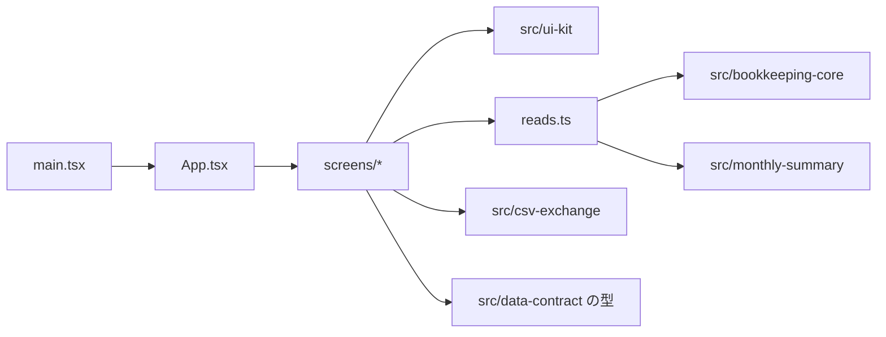

# 論理部品（app-screens）

- 出典: `security-design.md`、`performance-design.md`、`construction/app-screens/functional-design/`（entities.md、rules.md、functional-spec.md）、`inception/refined-mockups/mockups.md`（画面）、`inception/refined-mockups/interaction-spec.md`（部品の仕様）、`inception/contract-design/contract-summary.md`（C1〜C6）

## 1. 部品の一覧

| 部品 | 役割 | 予定のファイル | 関わる規則 |
|------|------|----------------|------------|
| エントリ | 起動（openBook）と S0-a・S0-b・再試行・アプリ枠の切り替え | `index.html`、`src/app/main.tsx`、`src/app/App.tsx` | BR1.2、BR1.6、BR8.4 |
| 状態（AppState） | 対象月、現在のタブ、Book、画面の知らせの共有（React の状態のみ） | `src/app/appState.ts` | BR1.4、BR1.5 |
| TabNav・MonthNavigator | タブと月の切り替え（U2 の Tabs を使う） | `src/app/TabNav.tsx`、`src/app/MonthNavigator.tsx` | BR1.4、BR9.1 |
| 収支画面 | 登録フォーム、月の一覧、編集、削除（D1） | `src/app/screens/TransactionsScreen.tsx`、`TransactionForm.tsx`、`TransactionList.tsx` | BR2.1〜BR2.5 |
| 月次集計画面 | 3つの合計、支出の行、収入の行、案内 | `src/app/screens/SummaryScreen.tsx` | BR5.1〜BR5.4 |
| 予算画面 | 支出カテゴリの予算の行、保存、設定を外す | `src/app/screens/BudgetScreen.tsx` | BR4.1〜BR4.3 |
| カテゴリ画面 | 一覧、追加、名前変更、削除（D2） | `src/app/screens/CategoriesScreen.tsx` | BR3.1〜BR3.5 |
| CSV 画面 | 書き出し、ファイル選択、理由の表示、D3 | `src/app/screens/CsvScreen.tsx`、`CsvExportPanel.tsx`、`CsvImportPanel.tsx`、`ImportPreviewDialog.tsx` | BR6.1〜BR6.3、BR7.1〜BR7.5 |
| 状態表示 | 読み込み中、失敗、保存失敗の知らせ（U2 の StatusPanel と InlineMessage） | `src/app/status.tsx` | BR8.1〜BR8.3 |
| 文言 | 画面だけの文言（操作の文言、案内）。U1・U4・U6 の文言は使い回す | `src/app/messages.ts` | BR1.1、BR7.1 |
| 読み取りの窓口 | 画面が使う読み取りを1か所にまとめ、要求の連番を付ける | `src/app/reads.ts` | BR1.4、BR8.1 |
| ビルドと検証 | Vite の設定、テストの設定、ESLint の `src/app` のブロック、tsconfig の JSX 設定、package.json のスクリプト（dev、build、preview） | `vite.config.ts`、`vitest.config.ts`（app 用プロジェクト）、`eslint.config.js`（src/app のブロック）、`tsconfig.json`（jsx）、`package.json` | NFR9.1、NFR1.1、NFR6.1 |
| 計測 | 操作の時間を開発用にだけ記録する | `src/app/perf.ts` | performance-design 3章 |

## 2. 依存の向き

テキストでの説明: 起動点は App を描画する。画面は U2 の部品、U4・U5・U6 の公開窓口を使う。保存（U3）は画面から直接 import しない（openBook の中だけで使われる）。U7 は U4・U5・U6 の内部ファイルを import しない。

## 3. 状態の持ち方

- 状態は React の状態（useState、useReducer）だけにする。保存や通信のための状態管理ライブラリは使わない（tech-stack-decisions）。
- 読み取りの結果は画面ごとに持ち、タブを切り替えると破棄する（BR1.4。保存していない入力も破棄する）。
- 対象月だけをアプリ全体で共有する。

## 4. 他の Unit との境界

- U7 は契約 C1〜C6 の公開窓口だけを使う。契約の変更はない。
- U2 の部品の props は C6 のとおり。ref は React 19 の通常の prop として渡す（U2 の確定）。
