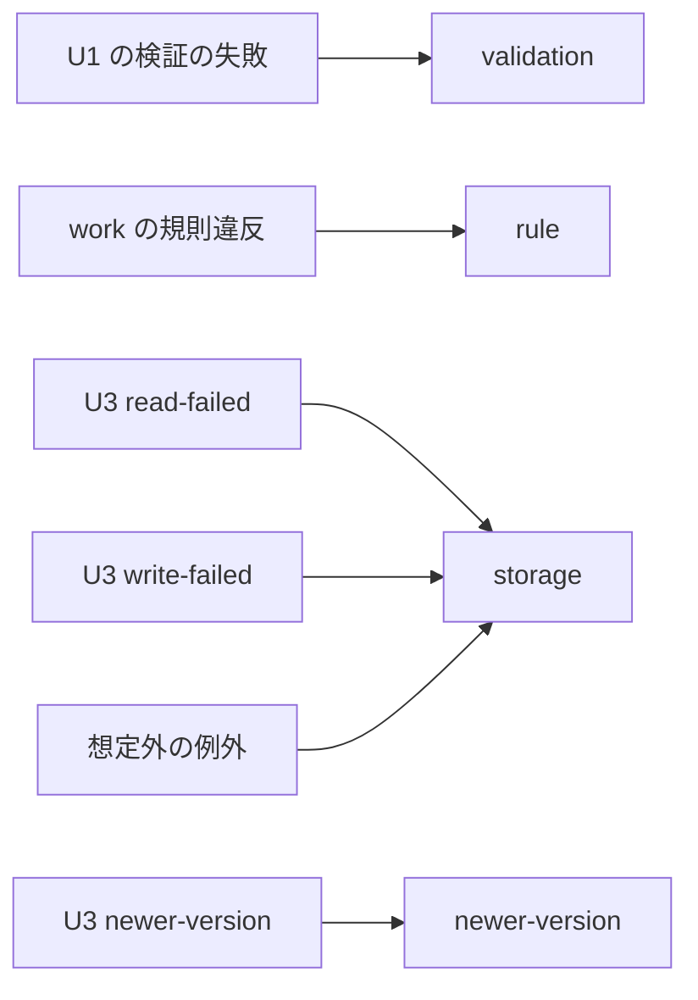

# 機能仕様（bookkeeping-core）

- 出典: `entities.md`、`rules.md`、`inception/contract-design/contract-summary.md`（C1〜C3）、`inception/user-stories/stories.md`（US3.1〜US4.3 ほか）、`inception/domain-design/decisions.md`（ADR-002、ADR-003、ADR-007）、`inception/units-generation/unit-of-work-story-map.md`、`functional-design-questions.md`（Q1 = A）

## 1. 担当するストーリーと受け入れ条件

| ストーリー | 受け入れ条件 | 規則 |
|------------|--------------|------|
| US3.1 最初から使えるカテゴリが用意されている | AC3.1.1、AC3.1.2 | BR1.2、BR3.1 |
| US3.2 自分用のカテゴリを追加する | AC3.2.1、AC3.2.2、AC3.2.3 | BR3.2 |
| US3.3 カテゴリの名前を変える | AC3.3.1、AC3.3.2 | BR3.3 |
| US3.4 使わないカテゴリを消す | AC3.4.1、AC3.4.2、AC3.4.3、AC3.4.4 | BR3.4、BR2.6、BR2.1、BR6.3 |
| US4.1 カテゴリ別に月の予算を決める | AC4.1.1、AC4.1.2、AC4.1.3 | BR4.1、BR4.3、BR4.4 |
| US4.2 予算を設定していない月にも前の予算が使われる | AC4.2.1〜AC4.2.4 | BR4.3、BR4.4 |
| US4.3 予算の設定を外す | AC4.3.1、AC4.3.2 | BR4.2、BR4.3 |

U4 が担当しないが、操作の結果で支えるもの（表示は U7、取り込みの前処理は U6）: US2.1〜US2.5（BR2.1〜BR2.4）、US6.1（BR2.5）、US7.2（BR5.1）、US8.2・US8.3（BR1.1、BR1.3、BR6.1、BR6.2）。

## 2. 手順（ワークフロー）

### W1 家計簿を開く（openBook）

1. storage（既定は U3 の openStorage）を呼ぶ。失敗なら種類を status に置き換えて返す（BR1.1）。
2. categories の1回の書き込み処理で件数を数え、0 件なら初期カテゴリ10件を作る（BR1.2）。
3. 2 が失敗したら接続を閉じ、load-failed または newer-version を返す（BR1.3）。
4. `{ status: ready, book }` を返す。

### W2 読み取る（一覧・使用件数・その月の予算）

1. 月を受け取る操作は月を検証する（BR2.4）。
2. 必要な保存領域を1回の読み取り処理で読み、並べる・数える・計算する（BR2.4〜BR2.6、BR3.1、BR4.3）。
3. 失敗は OperationError に置き換える（BR6.1）。

### W3 書き込む（共通の流れ）

```text
operation(args):
  1. 入力を U1 で検証する。失敗 → { kind: validation }（保存に触れない）
  2. storage.write(対象の保存領域, (tx) => {
       保存領域から必要な値を読み直す（BR6.3）
       規則に反したら → { ok: false, error: { kind: rule, violation } }
       now()・newId() で日時と id を付け、put・delete する（BR6.4）
       → { ok: true, value: 結果 }
     })
  3. 結果を OperationError に置き換える（BR6.1）。例外は storage にする（BR6.2）
```

| 操作 | 対象の保存領域 | 書き込み処理の中で確かめること | 規則 |
|------|----------------|--------------------------------|------|
| addTransaction | transactions、categories | カテゴリの存在・種別 | BR2.1 |
| updateTransaction | transactions、categories | 収支の存在、カテゴリの存在・種別 | BR2.2 |
| deleteTransaction | transactions | 収支の存在 | BR2.3 |
| addCategory | categories | 名前の重複（同じ種別） | BR3.2 |
| renameCategory | categories | カテゴリの存在、名前の重複（自分以外） | BR3.3 |
| deleteCategory | transactions、categories、budgets | 存在 → 使用件数 → 最後の1件、予算の削除 | BR3.4 |
| setBudget | budgets、categories | カテゴリの存在・支出であること | BR4.1 |
| clearBudget | budgets | その月の設定の存在 | BR4.2 |
| importTransactions | transactions、categories | 全行のカテゴリの存在・種別 | BR5.1 |

### W4 その月に使う予算の計算（resolveEffectiveBudgets）

```text
resolveEffectiveBudgets(categories, budgets, month):
  for c in categories（支出のみ、BR3.1 の順）:
    past = budgets.filter(b => b.categoryId == c.id && b.month <= month)
    latest = past の month が最大のもの
    if latest なし         → { amount: null, source: none }
    else if latest.month == month → { amount: latest.amount, source: set }
    else                   → { amount: latest.amount, source: carried(from: latest.month) }
```

テキストでの説明: 支出カテゴリごとに、その月以前の設定のうち最も新しいものを使う。その月の設定なら「設定」、前の月の設定なら「引き継ぎ」、なければ「予算なし」。YYYY-MM の文字列は辞書順と月の順が一致するため、文字列の比較で前後を決める。

### 例（AC4.2.1・AC4.2.3・AC4.3.1・AC4.3.2）

| 設定 | 見る月 | 結果 |
|------|--------|------|
| 2026-08: 30,000、2026-10: 25,000 | 2026-09 | 30,000（引き継ぎ、from 2026-08） |
| 同上 | 2026-11 | 25,000（引き継ぎ、from 2026-10） |
| 2026-08: 30,000 だけ | 2026-07 | 予算なし |
| 2026-08: 30,000、2026-10 を解除 | 2026-10 | 30,000（引き継ぎ、from 2026-08） |
| 2026-10: 0 | 2026-10 | 0（設定。支出があれば U5 で超過） |

## 3. 失敗の置き換え（BR6.1）



テキストでの説明: 入力の検証の失敗は validation、書き込み処理の中で見つけた規則違反は rule、保存の読み書きの失敗と想定外の例外は storage、別のタブでの版上げは newer-version になる。U7 は storage なら保存失敗の知らせと再試行（入力は残す）、newer-version なら開くときと同じ「新しい版」の画面に切り替える（Q1 = A）。

## 4. 規則違反と画面の文言の対応（U7 への引き継ぎ）

| 違反 | U7 が出す文言の例 | 受け入れ条件 |
|------|-------------------|--------------|
| category-missing | 選んだカテゴリが見つかりません。画面を更新してください | AC3.4.4 |
| category-type-mismatch | 選んだカテゴリの種別が違います。画面を更新してください | — |
| category-in-use（count） | ｛count｝件の収支で使われています | AC3.4.1 |
| last-category-of-type | 収入・支出のカテゴリはそれぞれ1件以上必要です | AC3.4.3 |
| not-found | 対象が見つかりません。画面を更新してください | — |
| budget-not-set | この月には予算が設定されていません | — |
| import-category-missing（lines） | ｛行番号｝行目のカテゴリが見つかりません。プレビューからやり直してください | AC7.2.3 の関連 |

文言そのものは U7 の Functional Design で確定する（U4 は種類と値だけを返す）。

## 5. テストの観点（コード生成への引き継ぎ）

- テストは U3 の createMemoryStorage を差し替えとして使う。失敗の注入（failWrites・failReads・delayMs）で保存失敗と読み込み中を確かめる。
- 初回は10件、2回目は作らない。2つの openBook を同じ保存領域で続けて開いても10件のまま。
- 収支の追加・更新・削除の正常と、検証・カテゴリの存在・種別・存在しない id の失敗。失敗の後に保存領域が変わらない。
- 一覧の並び（同じ日付・同じ登録日時の並び）、日付を別の月に変えた収支の移動、空の月。
- カテゴリの追加（末尾の sortOrder）・重複（全角・大文字小文字）・空白・21文字、名前変更の重複（自分自身は除く）、削除の3つの拒否の順序と予算の削除件数。
- 予算の設定・解除・引き継ぎ（2章の例の表）、0 円と未設定の区別、収入カテゴリへの設定の拒否、不正な金額（-1、12.5、abc）。
- 取り込み: 全件追加、検証エラーの行がある・カテゴリがない行がある場合は0件、0行。
- 別タブでの変更の再現: 同じ保存領域を2つの Book で開き、片方でカテゴリを消した後、もう片方でそのカテゴリの収支を追加すると category-missing。
- newer-version: 差し替えでは実行中の newer-version を起こす指定がない（U3 のレビュー Minor）。U3 の本物（fake-indexeddb）で版上げを起こすテストを U4 に1件置くか、差し替えに指定を足すかをコード生成の計画で決める。
- 偽のタイマーは使わない（U3 の差し替えの自動確定の再現が実際のタイマーに依存するため、U3 のレビュー Minor）。

## 6. 契約 C3 との差分

- OperationError に `{ kind: "newer-version" }` を加える（Q1 = A）。
- openBook の任意の引数に `now?: () => Date`、`newId?: () => string` を加える。
- listCategories の並びを「支出の後に収入、各 sortOrder 順」と明記する（BR3.1）。
- コード生成で contract-summary.md の C3 を同じ変更で更新する。
