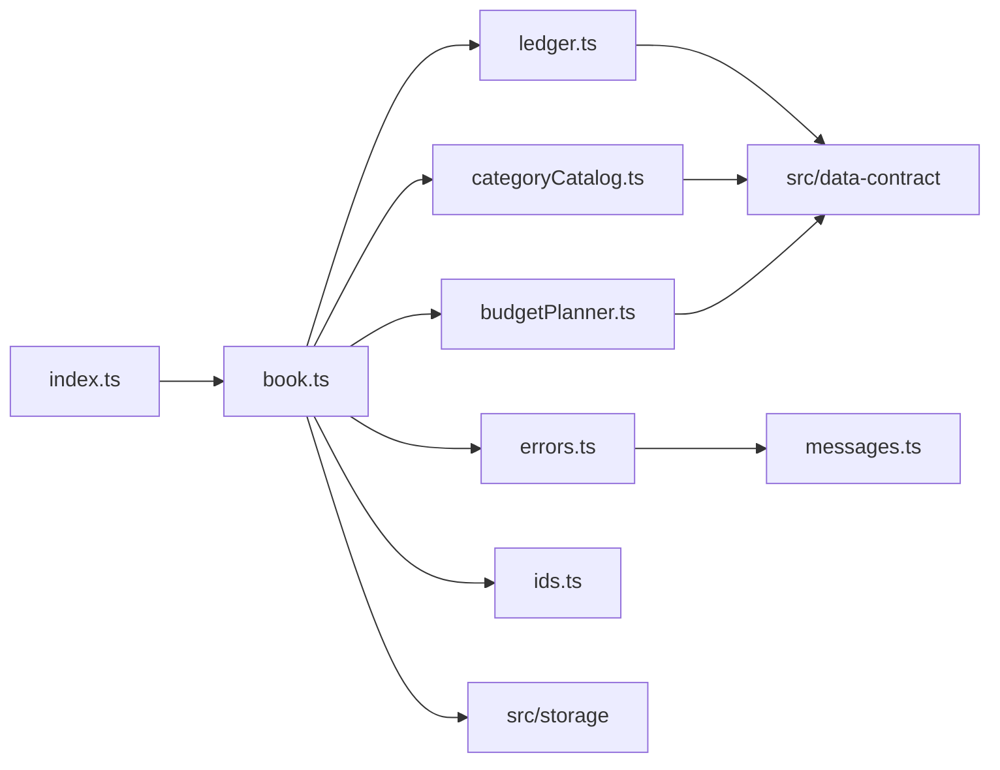

# 論理部品（bookkeeping-core）

- 出典: `security-design.md`、`construction/bookkeeping-core/functional-design/`（entities.md、rules.md、functional-spec.md）、`inception/domain-design/components.md`（Ledger、CategoryCatalog、BudgetPlanner、BookkeepingService）、`inception/domain-design/decisions.md`（ADR-002、ADR-007）、`inception/contract-design/contract-summary.md`（C3）、`nfr-design-questions.md`（Q1 = A）

## 1. 部品の一覧

| 部品 | 役割 | 予定のファイル | 関わる規則・NFR |
|------|------|----------------|-----------------|
| ledger | 収支の作成・更新・削除の値の組み立て、一覧の並び（純粋な関数と TxContext を使う関数） | `src/bookkeeping-core/ledger.ts` | BR2.1〜BR2.6 |
| category-catalog | 初期カテゴリ、カテゴリの追加・名前変更・削除の判定、一覧の並び | `src/bookkeeping-core/categoryCatalog.ts` | BR1.2、BR3.1〜BR3.4 |
| budget-planner | 予算の設定・解除、その月に使う予算の計算（resolveEffectiveBudgets は純粋な関数） | `src/bookkeeping-core/budgetPlanner.ts` | BR4.1〜BR4.4、NFR5.1 |
| bookkeeping-service | openBook と Book の実装。runWrite・runRead、部品をまたぐ規則の順序、取り込み | `src/bookkeeping-core/book.ts` | BR1.1、BR1.3、BR5.1、BR6.1〜BR6.4 |
| errors | OperationError への置き換え | `src/bookkeeping-core/errors.ts` | BR6.1、BR6.2 |
| messages | U4 が作る検証エラーの文言 | `src/bookkeeping-core/messages.ts` | NFR8.3 |
| ids | id と日時の既定（randomUUID と代わりの作り方） | `src/bookkeeping-core/ids.ts` | security-design 6章 |
| 公開の窓口 | C3 の型と openBook、resolveEffectiveBudgets の再公開 | `src/bookkeeping-core/index.ts`、`types.ts` | C3 |

## 2. 失敗の影響の範囲

| 失敗 | 影響の範囲 | 止める仕組み |
|------|------------|--------------|
| 1つの書き込み操作の失敗 | その操作だけ。保存領域は元のまま | U3 の1回の書き込み処理（runWrite） |
| 別のタブでの変更 | このタブの次の書き込みが規則違反になる | 処理の中での読み直し |
| 別のタブでの版上げ | このタブの Book 全体。以後の操作は newer-version | U3 の切断と OperationError の newer-version |

## 3. 依存の向き

テキストでの説明: 公開の窓口は book を再公開する。book（調整役）だけが3つの持ち主（ledger、category-catalog、budget-planner）と保存（U3）を使う。持ち主同士は互いに依存しない（ADR-002）。持ち主は U1 の型と検証だけに依存する。U4 は U2・U5〜U7 に依存しない。

## 4. 他の Unit との境界（C3 の更新）

コード生成で contract-summary.md の C3 を同じ変更で更新する。

- OperationError に `{ kind: "newer-version" }` を加える（FD Q1 = A）。
- OperationError の validation に任意の `line?: number` を加える（取り込みの再検証で失敗した行）。
- getCategoryUsage の戻り値を `Record<string, { transactions: number; budgets: number }>` にする（NFR Design Q1 = A）。
- openBook の任意の引数に `now?: () => Date`、`newId?: () => string` を加える。
- listCategories の並び（支出の後に収入、各 sortOrder 順）を明記する。
- 利用者の U5〜U7 はまだないため、変更の影響はない。U5〜U7 の Functional Design は更新後の C3 を読む。
