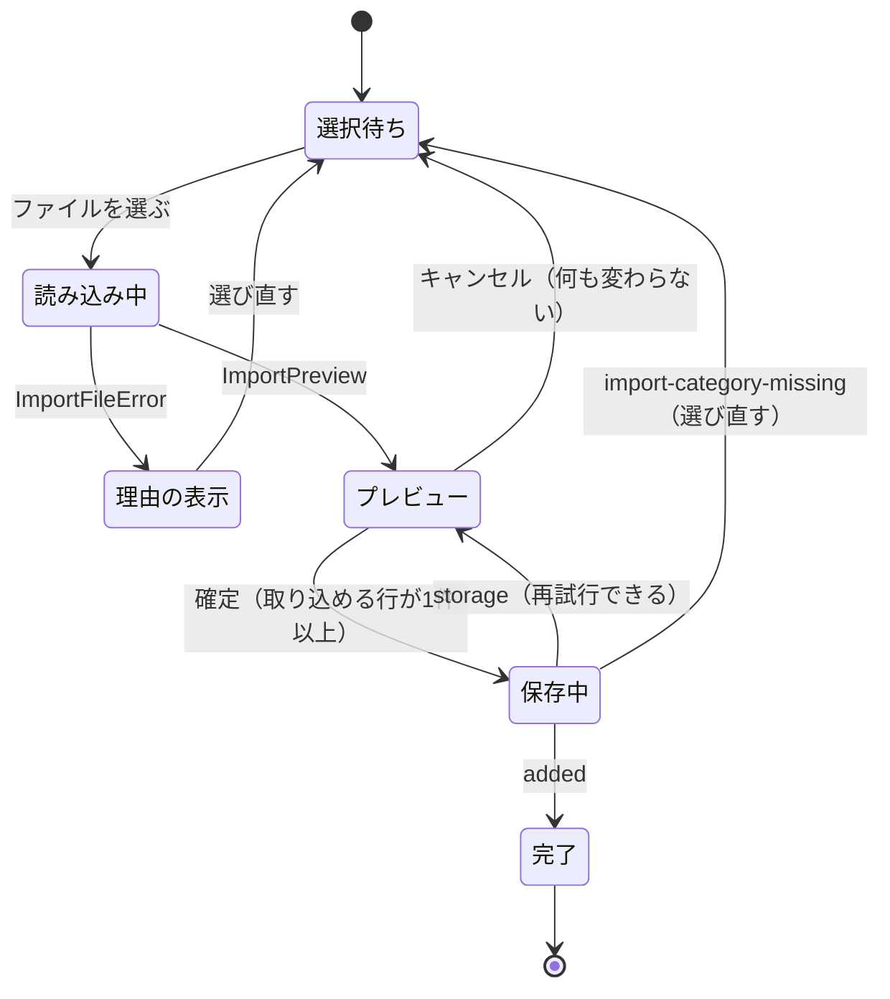

# 機能仕様（csv-exchange）

- 出典: `entities.md`、`rules.md`、`inception/contract-design/contract-summary.md`（C1、C3、C5）、`inception/user-stories/stories.md`（US6.1〜US7.4）、`inception/requirements-analysis/requirements.md`（FR1.5、FR6、FR7）、`functional-design-questions.md`（Q1 = A）

## 1. 担当するストーリーと受け入れ条件

| ストーリー | 受け入れ条件 | 規則 |
|------------|--------------|------|
| US6.1 収支を CSV に書き出す | AC6.1.1〜AC6.1.4 | BR1.1、BR1.2 |
| US6.2 書き出した CSV を表計算ソフトで開いても安全 | AC6.2.1〜AC6.2.3 | BR1.4、BR3.4 |
| US6.3 書き出す収支がないときにそれが分かる | AC6.3.1 | BR1.3 |
| US7.1 読み込む前に中身を確かめる | AC7.1.1〜AC7.1.4 | BR2.2、BR3.1〜BR3.3、BR3.8 |
| US7.2 確かめた行だけを取り込む | AC7.2.1〜AC7.2.4 | BR4.1〜BR4.3 |
| US7.3 読み込めないファイルの理由が分かる | AC7.3.1〜AC7.3.3 | BR2.1、BR2.3、BR2.4 |
| US7.4 既にある収支と同じ行に気づく | AC7.4.1、AC7.4.2 | BR3.6、BR4.1 |

ファイル選択のキーボード操作（FR7.1）と、プレビュー・文言の表示は U7（U2 の FileInput を使う）が担当する。

## 2. 手順（ワークフロー）

### W1 書き出す（exportTransactions）

1. U4 から対象の収支（日付の古い順）とカテゴリを取る（BR1.1）。失敗はそのまま返す。
2. 収支を CsvRecord にして U1 の encodeCsv にかける（BR1.1、BR1.4）。カテゴリを引けなければ止める（BR1.5）。
3. ファイル名を決め（BR1.2）、Blob と件数、見出しのみかどうかを返す（BR1.3）。

### W2 読み込んでプレビューを作る（parseImportFile）

```text
parseImportFile(book, file):
  if file.size > 1MB                    → too-large            （BR2.1）
  text = UTF-8 として厳密に読む          → 失敗は read-failed     （BR2.2）
  lines = decodeCsv(text)               → empty / header-mismatch / malformed（BR2.3）
  if lines.length > 5000                → too-many-rows        （BR2.4）
  categories = book.listCategories(); existing = book.listAllTransactions("all")（失敗はそのまま返す）
  for each line（行番号の昇順）:
    列の数が 5 でない → invalid（BR3.1）
    validateCsvRecord の失敗の文言 ＋ カテゴリの照合の結果 → 理由が1つでもあれば invalid（BR3.2、BR3.3）
    それ以外 → valid（BR3.4）、既存と同じなら sameAsExisting（BR3.6）
  → { fileName, validRows, invalidRows }（BR3.7、BR3.8）
```

テキストでの説明: 大きさ → 文字コード → CSV の形 → 件数の順にファイル全体を確かめ、どれかに当たればプレビューを作らずに理由を返す。通ったら1行ずつ、列の数、値、カテゴリの順に確かめ、取り込める行と取り込めない行に分ける。

### W3 確定する（commitImport）

1. 取り込める行が0件なら何もせず `{ added: 0 }`（BR4.1）。
2. 取り込める行を ImportRow にして U4 の importTransactions に1回で渡す（BR4.1）。
3. U4 の結果をそのまま返す。プレビュー後にカテゴリが消えていれば import-category-missing（BR4.2）、保存失敗は storage（何も追加されない）。

### 状態の流れ（画面の側から見た U6 の呼び出し）



テキストでの説明: ファイルを選ぶと読み込み、読めなければ理由を出して選び直す。読めればプレビューを出し、キャンセルなら何も変えずに戻る。確定すると保存し、成功すれば完了、保存失敗ならプレビューに戻って再試行でき、プレビューの後にカテゴリが消えていた場合は選び直す。

## 3. 理由の文言（U7 が「｛行番号｝行目：」を前に付けて表示する）

| 場面 | 文言 | 出どころ |
|------|------|----------|
| 列の数が5でない | 列の数が違います（5列にしてください） | U6（BR3.1） |
| 値の検証の失敗 | U1 の ValidationError.message（例: 金額：1〜99,999,999 の整数で入力してください） | U1（BR3.2） |
| カテゴリが別の種別にだけある | カテゴリ：種別と一致しません | U6（BR3.3） |
| カテゴリがどの種別にもない | カテゴリ：見つかりません | U6（BR3.3） |
| UTF-8 でない | UTF-8 の CSV ファイルを選んでください | U6（BR2.2） |
| ファイルを読めない | ファイルを読み込めませんでした | U6（BR2.2） |

ファイル全体の理由（too-large、too-many-rows、empty、header-mismatch、malformed）の画面の文言（「1MB を超えるファイルは読み込めません」「データがありません」「見出し行の形式が違います」など）は U7 が決める。malformed の message は U1 の文言（「引用が閉じられていません」等）。

## 4. 例

| 入力 | 結果 | 受け入れ条件 |
|------|------|--------------|
| 正しい行3件と、3行目の金額が abc | 取り込める行3件、取り込めない行1件（3行目、金額の理由） | AC7.1.1 |
| 存在しないカテゴリ名の行、income なのに支出カテゴリ名の行 | 2行とも取り込めない（見つかりません／種別と一致しません） | AC7.1.2 |
| CSV のカテゴリ名「ＦＯＯＤ」、アプリの支出カテゴリ「food」 | 照合できる（Q1 = A） | — |
| 見出し行のみ、または 0 バイト | empty | AC7.3.2 |
| 見出しを除き 5,001 件 | too-many-rows。5,000 件ならプレビュー | AC7.3.3 |
| メモ =SUM(A1) の収支を書き出して読み込み直す | ファイル上は '=SUM(A1)、プレビューのメモは =SUM(A1) | AC6.2.1、AC6.2.2 |

## 5. テストの観点（コード生成への引き継ぎ）

- テストの順序: U6 は「CSV 変換のレイヤー」なので、テストを先に書いて失敗を確かめてから実装する（team.md の Ordering）。
- Book は U4 の openBook に U3 の差し替え（createMemoryStorage）を渡して作る。File と Blob は Node.js 24 の組み込み（`new File([...], name)`）を使う。
- 書き出し: 全期間・月指定のファイル名（today を固定）、日付の古い順、BOM と CRLF、0件、数式対策、カンマ・ダブルクォート・改行を含むメモの往復（書き出したものを読み込み直して一致）。
- 読み込み: 1MB ちょうどと 1 バイト超え、5,000 件と 5,001 件、引用の中の改行を含むレコードの件数、BOM の有無と LF・CRLF、UTF-8 でないバイト列、空・見出しのみ・見出しの不一致・引用の閉じ忘れ、列の数の違い、検証の失敗の文言、カテゴリの照合（全角・大文字小文字、別の種別、どこにもない）、既存と同じ内容、すべて不正。
- 確定: 全件追加、0件、保存失敗（failWrites）で1件も増えない、プレビューの後にカテゴリを消してからの確定が import-category-missing で1件も増えない、書き出したファイルを空のアプリに取り込むと同じ内容になる（AC7.2.4）。
- 空データ: 収支0件の書き出し、取り込める行0件のプレビュー。読み込み中: 差し替えの delayMs の間はプレビューが未完了。
