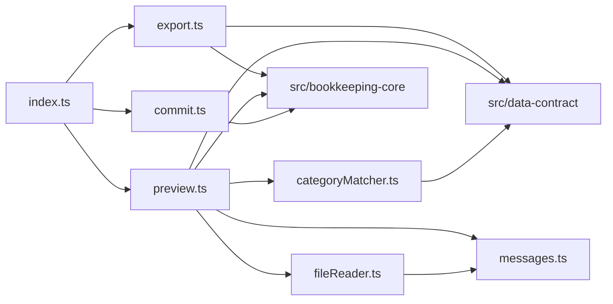

# 論理部品（csv-exchange）

- 出典: `security-design.md`、`construction/csv-exchange/functional-design/`（entities.md、rules.md、functional-spec.md）、`inception/domain-design/components.md`（CsvExchange）、`inception/contract-design/contract-summary.md`（C1、C3、C5）、`nfr-design-questions.md`（Q1 = A、Q2 = A）

## 1. 部品の一覧

| 部品 | 役割 | 予定のファイル | 関わる規則・NFR |
|------|------|----------------|-----------------|
| export | exportTransactions。CsvRecord への変換、ファイル名、Blob | `src/csv-exchange/export.ts` | BR1.1〜BR1.5、NFR3.2 |
| file-reader | ファイルの大きさの確認、UTF-8 の厳密な読み取り | `src/csv-exchange/fileReader.ts` | BR2.1、BR2.2 |
| category-matcher | カテゴリ名の照合表（Q1 = A、U1 の比較キー） | `src/csv-exchange/categoryMatcher.ts` | BR3.3 |
| preview | parseImportFile。復号の結果の確認、行の検証、既存と同じ内容の判定 | `src/csv-exchange/preview.ts` | BR2.3、BR2.4、BR3.1〜BR3.8、NFR3.1 |
| commit | commitImport。ImportRow への変換と U4 への1回の依頼 | `src/csv-exchange/commit.ts` | BR4.1〜BR4.3 |
| messages | U6 が作る理由の文言 | `src/csv-exchange/messages.ts` | NFR8.3 |
| 公開の窓口 | C5 の型と3つの関数 | `src/csv-exchange/index.ts`、`types.ts` | C5 |

## 2. 失敗の影響の範囲

| 失敗 | 影響の範囲 | 止める仕組み |
|------|------------|--------------|
| ファイル全体の理由（大きすぎ・多すぎ・空・見出し・形・読めない） | そのファイルの読み込みだけ。保存は変わらない | プレビューを作らずに理由を返す |
| 取り込めない行 | その行だけ。ほかの行はプレビューに残る | 行ごとの検証 |
| 確定の失敗 | その確定だけ。1件も追加されない | U4 の1回の書き込み処理 |

## 3. 依存の向き

テキストでの説明: 公開の窓口は書き出し・プレビュー・確定の3つを再公開する。プレビューはファイルの読み取り、カテゴリの照合、文言を使う。U1（data-contract）と U4（bookkeeping-core）は公開窓口だけを使い、U3（storage）は直接使わない。U6 は U2・U5・U7 に依存しない。

## 4. 他の Unit との境界

- C5 の型は変えない。照合の比べ方（FD Q1 = A）、検証に失敗した行では照合しないこと（NFR Design Q1 = A）、理由の文言（Q2 = A）は U6 の内部の規則。
- U7 へ: 取り込めない行の理由は「｛行番号｝行目：」を前に付けて表示する。ファイル全体の理由の画面の文言は U7 が決める。確定の import-category-missing では、行番号を示してファイルの選び直しを促す。名前の変更だけならプレビューの名前が古いまま取り込みが成功する。
