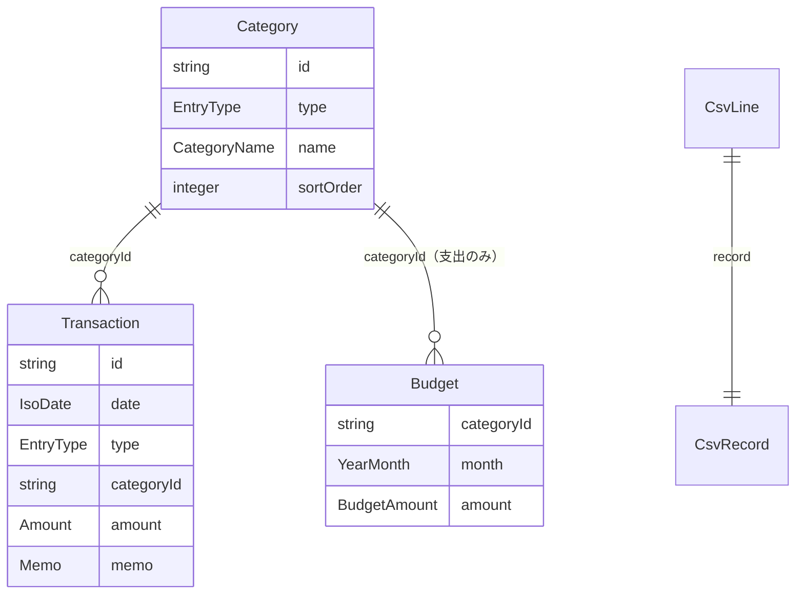

# 機能仕様（data-contract）

- 出典: `entities.md`、`rules.md`、`inception/contract-design/contract-summary.md`（C1）、`inception/units-generation/unit-of-work.md`（U1）、`inception/user-stories/stories.md`（US1.1、US6.2）
- U1 は状態を持たない純粋な判定・変換だけを提供する。そのため状態遷移はなく、この文書は「入力から結果までの手順」を定める。

## 1. 担当するストーリーと受け入れ条件

| ストーリー | 受け入れ条件 | 規則 |
|------------|--------------|------|
| US1.1 どの画面でも同じ規則で入力が検証される | AC1.1.1〜AC1.1.5 | BR1.1、BR1.3、BR1.4、BR2.1、BR2.2、BR3.1 |
| US6.2 書き出した CSV を表計算ソフトで開いても安全 | AC6.2.1〜AC6.2.3 | BR4.5、BR4.6 |

ほかの Unit が使う規則（BR1.2、BR1.5〜BR1.7、BR4.1〜BR4.4、BR4.7、BR5.1、BR6.1）もこの Unit が提供する。

## 2. 手順（ワークフロー）

### W1 収支の入力を検証する（validateTransactionInput）

1. 入力（日付・種別・カテゴリ id・金額・メモ）を受け取る。
2. 日付を BR1.1 で判定する。
3. 種別を BR1.5 で判定・正規化する（画面からは income / expense のみが来るが、同じ規則を使う）。
4. カテゴリ id が空でないかを BR1.6 で判定する（存在と種別の一致は U4 が確かめる）。
5. 金額を BR1.3 で正規化・判定する。
6. メモを BR1.4 で正規化・判定する。
7. エラーが1件でもあれば、BR1.7 の順でエラー一覧を「失敗」として返す。なければ正規化した値を「成功」として返す。

- 異常の扱い: 入力が想定外の型（null など）の場合も例外を投げず、該当項目の required として返す。

### W2 カテゴリ名を検証する（validateCategoryName）

1. 名前・種別・既存のカテゴリ一覧・（名前変更の場合）自分の id を受け取る。
2. BR2.1 で前後空白の除去と長さを判定する。
3. BR2.2 の比較キーを作り、同じ種別の既存カテゴリ（自分を除く）と比べる。
4. エラーがあれば「失敗」、なければ除去後の名前を「成功」として返す。

### W3 予算額を検証する（validateBudgetAmount）

1. 金額（文字列または数値）を受け取る。
2. BR3.1 で正規化・判定し、整数を返す。

### W4 収支の並びを CSV にする（encodeCsv）

1. CsvRecord の並びを受け取る（並べ替えは呼び出し側の責任。書き出しは日付の古い順で U6 が並べる）。
2. 各レコードの category・memo に BR4.5 を適用する。
3. BR4.2 に従い、BOM・見出し・各行を CRLF でつないで1つの文字列にする。
4. 0件のときは BOM と見出し行だけの文字列を返す（「見出しのみ」の知らせは U6 が行う）。

### W5 CSV を復号する（decodeCsv）

1. ファイルの文字列を受け取る（ファイルの読み取り、1MB・5,000 行の上限確認は U6 が先に行う）。
2. BR4.4 で空の判定を行い、空なら empty を返す。
3. BR4.3 で列と行に分け、各レコードに開始行の番号を付ける。引用が閉じなければ malformed を返す。
4. BR4.1 で見出しを判定し、一致しなければ header-mismatch を返す。
5. 見出しの後にレコードがなければ empty を返す（BR4.4）。
6. 各レコードの category・memo に BR4.6 を適用し、CsvLine の並びを「成功」として返す（行の値の検証は W1 と同じ規則で U6 が行う、BR4.7）。

## 3. 状態遷移

なし（U1 は状態を持たない）。

## 4. エンティティの関係（entities.md から導いた図）

テキストでの説明: 1つのカテゴリに複数の収支と（支出カテゴリなら）複数の予算が属する。CSV 行は1つの CSV レコードを持ち、カテゴリは名前で表す。

## 5. 規則の要約（rules.md から導いた表）

| 分類 | 規則 |
|------|------|
| 値の検証 | BR1.1 日付、BR1.2 対象月、BR1.3 金額、BR1.4 メモ、BR1.5 種別、BR1.6 必須、BR2.1 カテゴリ名、BR3.1 予算額 |
| 一意性 | BR2.2 カテゴリ名の重複 |
| CSV | BR4.1 見出し、BR4.2 書き出し、BR4.3 読み込み、BR4.4 空、BR4.5・BR4.6 数式対策の往復、BR4.7 列の検証 |
| その他 | BR1.7 エラーの順序、BR5.1 スキーマ版、BR6.1 文言 |

## 6. 境界値の例（テストの元になる）

| 規則 | 受け付ける | エラー |
|------|------------|--------|
| BR1.1 | 2000-01-01、2028-02-29、2099-12-31 | 2026-02-29（invalid-date）、2026-13-01（invalid-date）、1999-12-31（out-of-range-date）、2100-01-01（out-of-range-date）、2026/10/01（invalid-date）、空（required） |
| BR1.3 | 1、99999999、「１２００」→1200、「1,200」→1200 | 0、-1、1.5、100000000、「¥1200」、「1200円」、「abc」（not-integer または out-of-range） |
| BR1.4 | 200 文字、「 架空のランチ 」→「架空のランチ」 | 201 文字 |
| BR1.5 | income、EXPENSE、収入、支出 | 「入金」（invalid-type） |
| BR2.1・BR2.2 | 「書籍」、収入側の「食費」 | 「 食費 」・「ＦＯＯＤ」と「food」（duplicate-name）、空白のみ（blank）、21 文字（too-long） |
| BR3.1 | 0、99999999 | -1、12.5、「abc」 |
| BR4.5・BR4.6 | =SUM(A1)、+1、-1、@x、'=1、'abc、''=1 がすべて往復で一致 | — |
| BR4.1〜BR4.4 | BOM あり・なし、CRLF・LF、引用内の改行・カンマ・重ねたダブルクォート | 見出し `日付,金額`（header-mismatch）、0 バイト・見出しのみ（empty）、閉じていない引用（malformed） |

## 7. 他の Unit とのつながり

- U3・U4・U5・U6・U7 は、この Unit の公開窓口（契約 C1）だけを使う。
- 契約 C1 との差分: 検証エラーの種類に `out-of-range-date` を加える（Q2）。Contract Design の変更ルール（Q4）に従い、コード生成で `contract-summary.md` の C1 と、この Unit のテストを同じ変更で更新する。この時点で C1 を使うほかの Unit のコードはまだないため、ほかの Unit のテストへの影響はない。
- Contract Design のレビューで受け入れた指摘のうち、この Unit に関わる「複数行にまたがる CSV レコードの行番号」は BR4.3（レコードが始まる物理行）で決めた。
