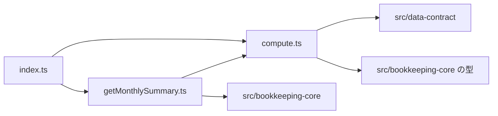

# 論理部品（monthly-summary）

- 出典: `security-design.md`、`construction/monthly-summary/functional-design/`（entities.md、rules.md、functional-spec.md）、`inception/domain-design/components.md`（MonthlySummary）、`inception/domain-design/decisions.md`（ADR-003）、`inception/contract-design/contract-summary.md`（C3、C4）

## 1. 部品の一覧

| 部品 | 役割 | 予定のファイル | 関わる規則・NFR |
|------|------|----------------|-----------------|
| compute | computeMonthlySummary。保存・時計に触れない純粋な計算 | `src/monthly-summary/compute.ts` | BR1.1〜BR3.2、NFR5.1、NFR5.2、NFR3.2 |
| fetch | getMonthlySummary。U4 の読み取り3回、食い違いの確認、失敗の置き換え | `src/monthly-summary/getMonthlySummary.ts` | BR4.1、BR4.2、NFR8.1、NFR8.2、NFR3.1 |
| 公開の窓口 | C4 の型と2つの関数 | `src/monthly-summary/index.ts`、`types.ts` | C4 |

## 2. 失敗の影響の範囲

| 失敗 | 影響の範囲 | 止める仕組み |
|------|------------|--------------|
| U4 の読み取りの失敗 | その月の集計の表示だけ | OperationError をそのまま返し、U7 が読み込みの失敗と再試行を表示 |
| 読み取りの間の食い違い | その月の集計の表示だけ | category-missing を返し、U7 が画面の更新を促す |

## 3. 依存の向き

テキストでの説明: 公開の窓口は計算と取得の2つを再公開する。取得は U4 の Book を呼び、結果を計算に渡す。計算は U1 と U4 の型だけに依存し、U4 の関数は呼ばない。U5 は U2・U3・U6・U7 に依存しない。

## 4. 他の Unit との境界

- C4 の型は変えない。
- U7 へ: 自分の書き込みの後に集計を取り直す。category-missing では「画面を更新してください」を出す。表示時のエスケープ、3桁区切り、マイナス記号と「赤字」「超過」「—（予算なし）」「引き継ぎ」の文字は U7。本物の IndexedDB と Chrome での表示の切り替え 500ms は U7 の Build and Test で確かめる。
