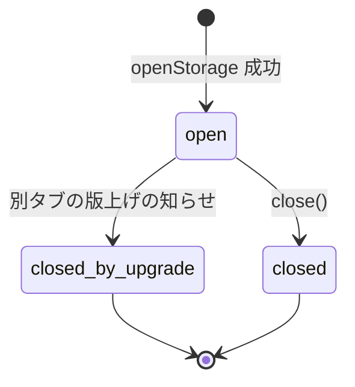
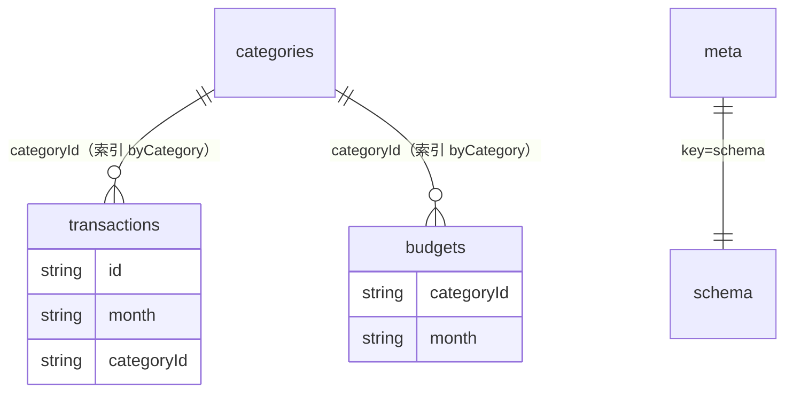

# 機能仕様（storage）

- 出典: `entities.md`、`rules.md`、`inception/contract-design/contract-summary.md`（C2）、`inception/user-stories/stories.md`（US1.2）、`inception/domain-design/decisions.md`（ADR-004）

## 1. 担当するストーリーと受け入れ条件

| ストーリー | 受け入れ条件 | 規則 |
|------------|--------------|------|
| US1.2 入力したデータが次に開いたときも残っている | AC1.2.1（再読み込み後も同じ収支と予算）、AC1.2.2（書き込みの途中失敗で何も書かれず既存データは残る）、AC1.2.3（現在の版は読み込み、新しい版のデータは書き換えず開けない旨） | BR1.2〜BR1.4、BR2.2 |

U7 が担当する US8.2〜US8.4（読み込み失敗・保存失敗・利用不可）の「失敗の種類」は、この Unit が区別して返す（BR1.1、BR2.1、BR2.2、BR3.1）。

## 2. 手順（ワークフロー）

### W1 保存領域を開く（openStorage）

1. 実行環境に IndexedDB がなければ unavailable を返す（BR1.1）。
2. データベースを SCHEMA_VERSION で開く要求を出す。
3. 版の更新が必要なら（初回または古い版）、保存領域・索引・メタ情報を作る、または版ごとの移行を行う（BR1.2、BR1.5）。
4. 別のタブが妨げていれば待つ。5 秒で進まなければ open-failed（BR3.2）。
5. データベースの版の方が新しければ newer-version（BR1.4）。
6. 開けたら、版の変更の知らせを受けたときに接続を閉じる設定をして（BR3.1）、StorageHandle を返す。
7. それ以外の失敗は open-failed。

### W2 読み取る（read）

1. 状態が closed-by-upgrade なら newer-version、closed なら read-failed を返す（BR3.1、BR4.1）。
2. 指定した保存領域を読み取り専用で開き、TxContext を work に渡す（BR2.1）。
3. work の結果を ok で返す。失敗・例外は read-failed。

### W3 書き込む（write）

1. 状態が closed-by-upgrade なら newer-version、closed なら write-failed（BR3.1、BR4.1）。
2. 指定した保存領域を1回の読み書きの処理として開き、TxContext を work に渡す（BR2.2）。
3. work が ok を返し、処理が完了したら ok を返す。
4. work が { ok: false } を返したら処理を取り消し、aborted を返す。
5. 例外・保存の失敗なら処理を取り消し、write-failed を返す。

## 3. 状態遷移（StorageHandle）

テキストでの説明: 開いた状態から、別のタブの版上げの知らせを受けると「版上げで閉じた」状態に、close を呼ぶと「閉じた」状態になる。どちらの状態からも読み書きはできず、それぞれ newer-version、read-failed／write-failed を返す。

| 状態 | read の結果 | write の結果 |
|------|-------------|--------------|
| open | work の結果、または read-failed | work の結果、aborted、または write-failed |
| closed-by-upgrade | newer-version | newer-version |
| closed | read-failed | write-failed |

## 4. 保存領域の関係（entities.md から導いた図）

テキストでの説明: 収支と予算はカテゴリの id で引ける索引を持つ。収支は対象月の索引も持つ。メタ情報は版を1件だけ持つ。参照の整合（存在しないカテゴリを参照しないこと）は U3 ではなく U4 が書き込み処理の中で守る。

## 5. 規則の要約

| 分類 | 規則 |
|------|------|
| 開く | BR1.1、BR1.2、BR1.4、BR1.5、BR3.2 |
| 読み書き | BR1.3、BR2.1〜BR2.4 |
| 状態 | BR3.1、BR4.1 |
| 安全 | BR4.2 |
| テスト用の差し替え | BR5.1、BR5.2 |

## 6. テストの観点（コード生成への引き継ぎ）

- 初回に開くと4つの保存領域と索引・メタ情報ができる。2回目は作り直さない。
- 収支を書いて読み直すと同じ値（month は返らない）。対象月の索引・カテゴリの索引で引ける。カテゴリ別の件数を数えられる。
- 書き込みの work が途中で例外を投げる・{ ok: false } を返すと、何も書かれず既存データが残る（AC1.2.2）。
- データベースの版を SCHEMA_VERSION より大きくしておくと newer-version で、データは変わらない（AC1.2.3）。
- 版の変更の知らせの後は read・write が newer-version。close の後は read-failed／write-failed。
- 処理の外での TxContext の使用、指定外の保存領域の操作は失敗。
- IndexedDB がない環境で unavailable。
- テスト用の差し替えでも同じテスト群が通る。failOpen・failReads・failWrites・delayMs が効く。

## 7. 契約 C2 との差分

- StorageError に `{ kind: "newer-version" }` を追加（Q1）。コード生成で contract-summary.md の C2 を同じ変更で更新する。
- `RecordOf`・`KeyOf`・`MetaRecord` を公開の型として出す（Contract Design のレビュー指摘 Minor への対応）。
- `write` の取り消し理由（aborted.reason）は、work が返した失敗の値をそのまま返す。型は呼び出し側の work の失敗の型を引き継ぐ（`write<T, E>` とし、`aborted.reason: E`）。Contract Design のレビュー指摘（`unknown` では型の保証がない）への対応。
