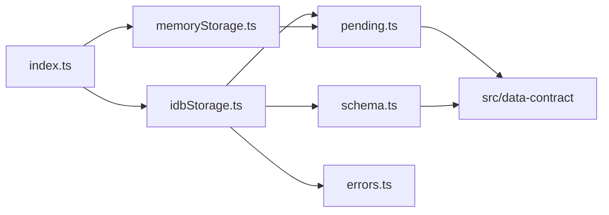

# 論理部品（storage）

- 出典: `security-design.md`、`construction/storage/functional-design/functional-spec.md`、`construction/storage/functional-design/entities.md`、`inception/contract-design/contract-summary.md`（C2）、`nfr-design-questions.md`（Q1 = A）

## 1. 部品の一覧

| 部品 | 役割 | 予定のファイル | 関わる NFR |
|------|------|----------------|------------|
| schema | 保存領域・索引・メタ情報の名前と作り方、版ごとの移行 | `src/storage/schema.ts` | NFR4.3 |
| pending | 変更の溜め場所と、読み取りへの重ね方（本物と差し替えで共用） | `src/storage/pending.ts` | NFR4.1、NFR4.2 |
| idb-storage | openStorage。IndexedDB を開く・版の確認・切断・read・write | `src/storage/idbStorage.ts` | NFR4.1〜NFR4.4、NFR7.1 |
| memory-storage | createMemoryStorage。保存領域の写しへの当て込みと失敗の注入 | `src/storage/memoryStorage.ts` | NFR4.1、NFR4.4 |
| errors | 失敗の種類の判定（容量超過、拒否、その他） | `src/storage/errors.ts` | NFR4.4、NFR7.1 |
| 公開の窓口 | 型（StorageHandle、TxContext、RecordOf、KeyOf、MetaRecord、StorageError）と関数の再公開 | `src/storage/index.ts` | — |
| 契約テスト | 本物と差し替えに同じテストを流す | `src/storage/contract.test.ts` ほか | NFR6.1、NFR6.2 |

## 2. 失敗の影響の範囲

| 失敗 | 影響の範囲 | 止める仕組み |
|------|------------|--------------|
| 1回の write の失敗 | その write だけ。保存領域は元のまま | まとめて保存と取り消し（security-design.md 1章） |
| 別タブの版上げ | このタブの接続だけ。以後の読み書きは newer-version | 切断と状態 closed-by-upgrade |
| IndexedDB の利用不可 | アプリ全体が保存できない。U7 が利用不可の画面を出す | unavailable の返却（U4 の openBook 経由） |

## 3. 依存の向き

テキストでの説明: 公開の窓口は本物と差し替えを再公開する。本物と差し替えは、溜め場所の部品を共用する。本物だけが schema と errors を使う。溜め場所と schema は U1 の型（収支・カテゴリ・予算、SCHEMA_VERSION）だけに依存する。U3 は U2・U4〜U7 に依存しない。

## 4. 他の Unit との境界

- U4 は C2 の窓口だけを使い、IndexedDB を直接使わない。
- C2 の更新（コード生成で同時に行う）: StorageError に newer-version、`write<T, E>` と `aborted.reason: E`、`RecordOf`・`KeyOf`・`MetaRecord` の公開、`openStorage` の任意の引数（dbName、indexedDB、now、blockedTimeoutMs）、write の説明に「put・delete は work の成功後にまとめて保存する。別の周回に進む待ちの後は write-failed」を加える。
- C3 への影響（U4 の Functional Design で決める）: U4 の OperationError が newer-version を伝えるかどうか（FD レビュー Major）。
