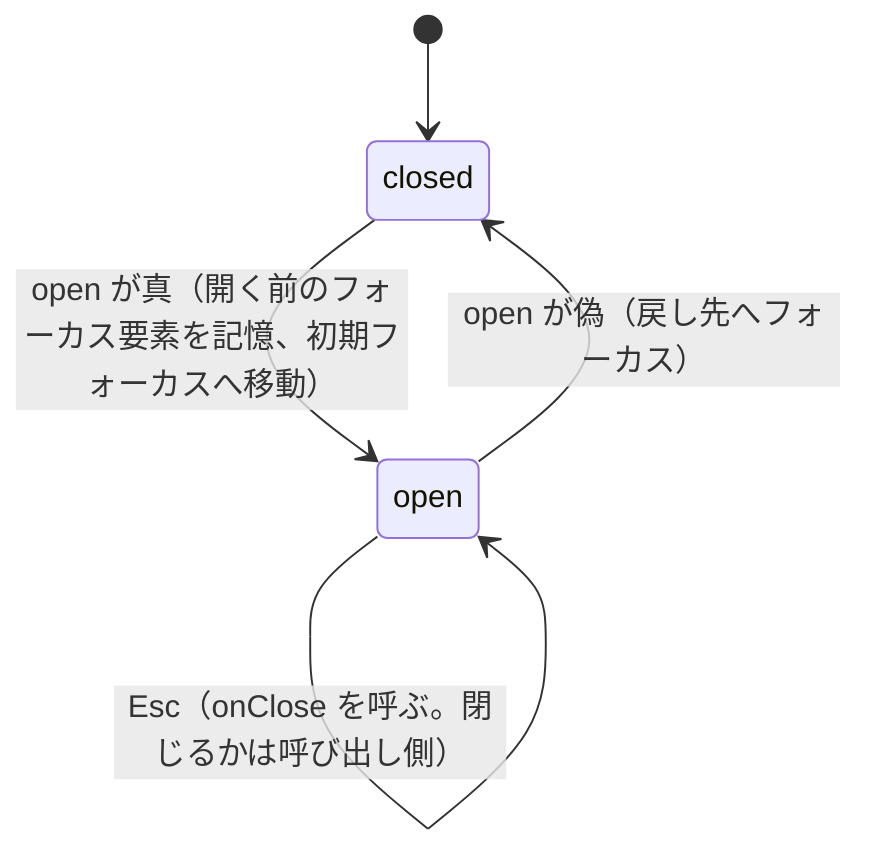
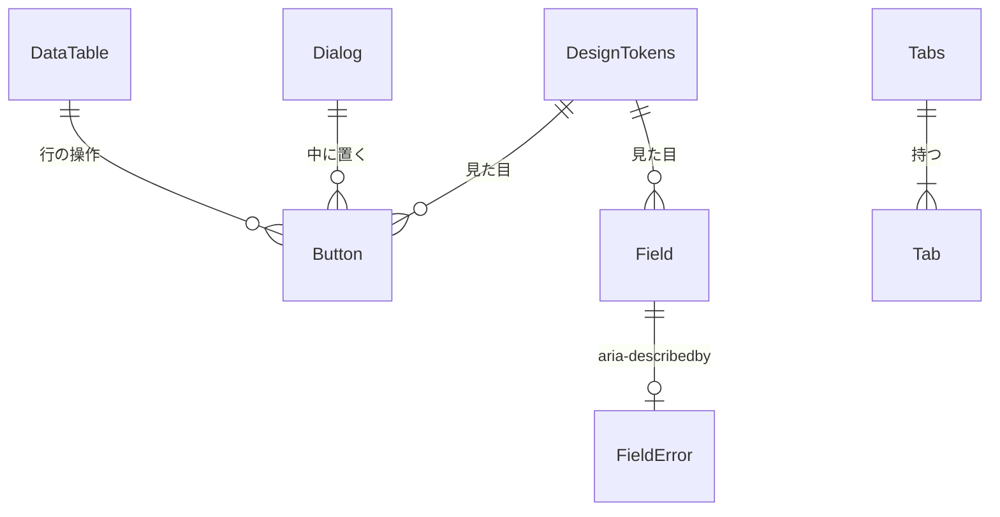

# 機能仕様（ui-kit）

- 出典: `entities.md`、`rules.md`、`inception/refined-mockups/interaction-spec.md`、`accessibility-checklist.md`、`inception/contract-design/contract-summary.md`（C6）、`inception/user-stories/stories.md`（US9.2）
- U2 は業務の知識を持たない見た目の部品の集まり。画面の組み立てと業務の操作は U7 が行う。

## 1. 担当するストーリーと受け入れ条件

| ストーリー | 受け入れ条件 | 規則 |
|------------|--------------|------|
| US9.2 ダイアログでフォーカスが迷子にならない | AC9.2.1（ダイアログ内に閉じ込め）、AC9.2.2（Esc で閉じて削除ボタンへ戻る）、AC9.2.3（プレビューを Esc で閉じてファイル選択へ戻る） | BR5.1〜BR5.6 |

U7 が担当するストーリー（US8.1、US9.1、US9.3 など）のうち、部品の側で満たす振る舞い（読み上げの役割、エラーの関連づけ、キーボード操作）も、この Unit の規則で提供する。

## 2. 手順（ワークフロー）

### W1 ダイアログを開いて閉じる

1. 呼び出し側が open を真にする。
2. 開く前にフォーカスがあった要素を記憶する（BR5.1）。
3. 標準の dialog をモーダル表示で開く。背後はブラウザによって操作できなくなる（BR5.1）。
4. initialFocus があればそこへ、なければ最初の操作要素へフォーカスを移す（BR5.2）。
5. 利用者が Tab・Shift+Tab を押すと、ダイアログの中で循環する（BR5.3）。
6. 利用者が Esc を押すと onClose("escape") を呼ぶ（BR5.4）。ボタンでの取り消しは呼び出し側が onClose("cancel") 相当として扱う。
7. 呼び出し側が open を偽にすると、ダイアログを閉じ、returnFocus またはステップ2の要素へフォーカスを戻す（BR5.5）。

### W2 タブを切り替える

1. 利用者がタブ列で左右の矢印・Home・End を押す。
2. 移動先のタブにフォーカスを移し、onSelect(id) を呼ぶ（BR8.2）。
3. 呼び出し側が selectedId を変えると、選択の表示（下線・太字・aria-selected）と tabindex が変わり、対応する内容が表示される（BR8.1、BR8.3）。
4. 利用者が Tab を押すと、タブ列から内容の最初の操作要素へ移る。

### W3 知らせを表示する

1. 呼び出し側が InlineMessage を tone と文言で表示する。
2. success なら 5 秒後に消え、onHidden を呼ぶ（BR6.3）。error なら消えない（BR6.4）。

### W4 読み込み中の遅延を知らせる

1. StatusPanel が loading で表示される。
2. slowAfterMs（既定 5,000ms）経過しても loading のままなら追記を表示する（BR6.2）。
3. kind が別のものに変われば追記を消す。

## 3. 状態遷移

### Dialog

テキストでの説明: 閉じた状態から、open が真になると開く。開いている間は Tab で中を循環し、Esc では呼び出し側に閉じる理由を伝えるだけで、実際に閉じるのは呼び出し側が open を偽にしたとき。閉じるとフォーカスを戻す。

### StatusPanel（loading のとき）

| 状態 | 出来事 | 次の状態 |
|------|--------|----------|
| 読み込み中 | slowAfterMs が経過 | 読み込み中（追記あり） |
| 読み込み中・読み込み中（追記あり） | kind が変わる | その kind の表示（追記なし） |

## 4. 部品の関係

テキストでの説明: すべての部品はデザイントークンで見た目を決める。入力欄は自分のエラー表示と結び付く。ダイアログと表はボタンを中に置ける。タブは複数のタブを持つ。

## 5. 規則の要約

| 分類 | 規則 |
|------|------|
| 外部資源と動き | BR1.1、BR1.2 |
| ボタン | BR2.1〜BR2.4 |
| 入力欄 | BR3.1〜BR3.3 |
| 表 | BR4.1、BR4.2 |
| ダイアログ | BR5.1〜BR5.6 |
| 状態表示・知らせ | BR6.1〜BR6.4 |
| ファイル選択 | BR7.1 |
| タブ | BR8.1〜BR8.3 |

## 6. テストの観点（コード生成への引き継ぎ）

- ダイアログ: 開いたときの初期フォーカス、最後の要素で Tab → 最初、最初で Shift+Tab → 最後、Esc で onClose("escape")、閉じた後に戻し先へフォーカス、戻し先が消えていた場合に例外にならない。
- タブ: 右・左・Home・End の移動と回り込み、tabindex と aria-selected。
- 入力欄: ラベルの関連づけ、error 指定時の aria-invalid と aria-describedby、必須の表示。
- ボタン: busy 中に押しても onClick が呼ばれない、文言の切り替え。
- 状態表示: 種類ごとの文言と role、slowAfterMs 経過後の追記。
- 知らせ: success は 5 秒後に消える、error は消えない。
- ファイル選択: 選んだファイルが渡される、選択後に値が空に戻る。
- 自動のアクセシビリティ検査（違反0件）を部品ごとに行う（NFR2）。

## 7. 契約 C6 との差分

- Button・TextField・Select・RadioGroup・FileInput が DOM 要素への参照を公開する（BR2.4）。Contract Design のレビュー指摘 R-09 への対応。契約の変更ルール（Q4）に従い、コード生成で contract-summary.md の C6 を同じ変更で更新する。
- Dialog の onClose に閉じる理由（escape・cancel）を渡す（BR5.4）。任意の引数の追加。
- Tabs に disabled を持たせない（refined-mockups のレビュー指摘 R-05：起動時の特殊画面ではタブを表示しない方針に統一）。
