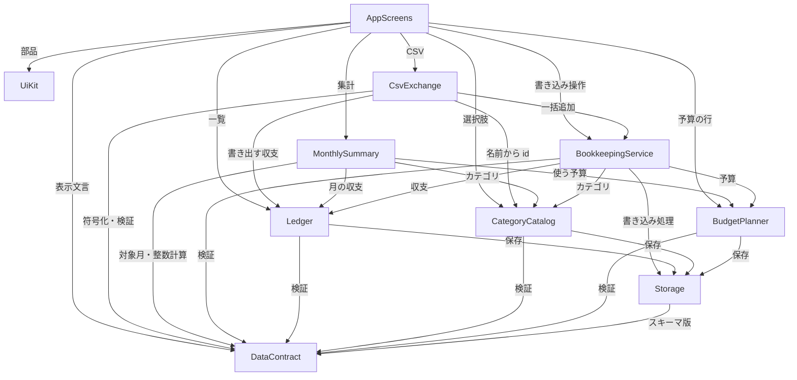

# コンポーネント一覧（Domain Design）

- 出典: `inception/requirements-analysis/requirements.md`（FR1〜FR9、NFR1〜NFR9）、`inception/user-stories/stories.md`（US1.1〜US9.3）、`inception/refined-mockups/`（画面と部品）、`domain-design-questions.md`（Q1〜Q4）
- ここで決めるのは、自分たちが書くコードの論理的な部品（コンポーネント）と、各データの持ち主である。IndexedDB などの基盤は部品ではなく、部品が使う外部依存として扱う。
- 部品をどの単位で実装・テストするか（Unit）は Units Generation で決める。技術の詳細（ライブラリ、型の厳密な定義）は Functional Design 以降で決める。
- 判断の記録は `decisions.md`（ADR-001〜ADR-007）にある。

## A. コンポーネント一覧（機械可読）

```yaml
components:
  - name: DataContract
    summary: 全部品が共有する共通データ契約（型の形、値の検証規則、CSV 形式、保存スキーマの版）
    behaviour: >
      収支・カテゴリ・予算の入力値と、日付（YYYY-MM-DD の実在する暦日）、対象月（YYYY-MM）、
      金額（1〜99,999,999 の整数円）、予算額（0〜99,999,999 の整数円）、メモ（0〜200文字）、
      カテゴリ名（前後空白除去後 1〜20 文字、同じ種別内で大文字小文字・全角半角を区別せず重複不可）の
      検証規則を純粋な関数として提供する。検証結果は「項目名・理由」のエラー一覧で返し、画面入力と
      CSV 読み込みで同じ関数・同じ文言を使う。CSV は見出し date,type,category,amount,memo、
      書き出しは UTF-8（BOM 付き）・CRLF、読み込みは BOM 有無と CRLF/LF を受け付け、RFC 4180 の
      引用規則に従う。数式として解釈される先頭文字（= + - @）と、先頭がシングルクォートで
      その後ろがこれらまたはシングルクォートで始まる値には、書き出し時に先頭へシングルクォートを
      1つ付け、読み込み時に1つ外す（往復で値が変わらない）。保存スキーマの版番号を定める。
      状態を持たず、どの部品にも依存しない。
    responsibilities:
      - 収支・カテゴリ・予算・CSV 行の形（属性名）の定義
      - 値オブジェクト（金額、日付、対象月、メモ、カテゴリ名）の検証と正規化
      - 項目名と理由を含む検証エラーの形と文言
      - CSV の行の符号化・復号（引用、改行、BOM、数式対策の往復）
      - 保存スキーマの版番号の定義
    depends_on: []
    dependents:
      - component: Storage
        interaction: 保存スキーマの版番号と保存する形を参照する
      - component: Ledger
        interaction: 収支の検証と正規化
      - component: CategoryCatalog
        interaction: カテゴリ名の検証と重複判定の比較規則
      - component: BudgetPlanner
        interaction: 予算額と対象月の検証
      - component: BookkeepingService
        interaction: 操作の入力を検証してから書き込む
      - component: MonthlySummary
        interaction: 対象月の判定（日付から YYYY-MM を得る）と金額の整数計算
      - component: CsvExchange
        interaction: CSV 行の符号化・復号と行の検証
      - component: AppScreens
        interaction: 入力欄の検証エラーの表示文言
    external_dependencies: []
    entities: []

  - name: Storage
    summary: IndexedDB への保存と読み込みを、複数のデータをまとめて扱える1回の書き込み処理として提供する
    behaviour: >
      起動時にデータベースを開き、IndexedDB が使えない場合は「利用不可」、保存データの版がアプリより
      新しい場合は「新しい版」としてデータに触れずに知らせる。古い版は定められた手順で現在の版へ
      移行する。書き込みは「1回の書き込み処理」の中で収支・カテゴリ・予算をまとめて読み書きでき、
      途中で失敗すれば全体を取り消す（全部成功か全部失敗）。読み込み・書き込みの失敗は
      種類（利用不可、版の不一致、書き込み失敗、読み込み失敗）を区別して呼び出し元に返し、
      握りつぶさない。ネットワークには一切アクセスしない。
    responsibilities:
      - データベースの開始、版の確認と移行
      - 収支・カテゴリ・予算の保存領域（ストア）の提供
      - 1回の書き込み処理（すべて成功かすべて取り消し）の提供
      - 保存・読み込みの失敗の種類の区別と通知
    depends_on:
      - component: DataContract
        interaction: 保存スキーマの版番号と保存する形
        style: sync
    dependents:
      - component: Ledger
        interaction: 収支の保存領域の読み書き
      - component: CategoryCatalog
        interaction: カテゴリの保存領域の読み書き
      - component: BudgetPlanner
        interaction: 予算の保存領域の読み書き
      - component: BookkeepingService
        interaction: 複数の部品にまたがる操作を1回の書き込み処理として実行する
    external_dependencies:
      - name: IndexedDB（ブラウザ組み込み）
        kind: database
        purpose: 収支・カテゴリ・予算・保存メタ情報の永続化
    entities:
      - name: StorageMeta
        identifier: key
        attributes: [key, schemaVersion, initializedAt]

  - name: Ledger
    summary: 収支（取引）の持ち主。収支の追加・更新・削除と、月別の一覧・カテゴリ別の使用件数を提供する
    behaviour: >
      収支は DataContract の規則で検証済みのものだけを保存する。id と登録日時・更新日時は Ledger が
      付与する。対象月の一覧は日付の新しい順、同じ日付は登録日時の新しい順、さらに同じなら id 順で返す。
      カテゴリごとの使用件数を、渡された書き込み処理の中で数えられるようにする（削除判定に使う）。
      他の部品の保存領域には触れない。
    responsibilities:
      - 収支の追加・更新・削除
      - 対象月の収支一覧（定められた並び順）
      - 期間（全期間・対象月）の収支の取得（集計・書き出し用）
      - カテゴリごとの使用件数の算出
    depends_on:
      - component: DataContract
        interaction: 収支の検証と正規化
        style: sync
      - component: Storage
        interaction: 収支の保存領域の読み書き
        style: sync
    dependents:
      - component: BookkeepingService
        interaction: 収支の登録・編集・削除・一括追加、カテゴリの使用件数
      - component: MonthlySummary
        interaction: 対象月の収支の取得
      - component: CsvExchange
        interaction: 書き出す収支の取得、既存と同じ内容の行の判定
      - component: AppScreens
        interaction: 収支一覧の表示
    external_dependencies: []
    entities:
      - name: Transaction
        identifier: id
        attributes: [id, date, type, categoryId, amount, memo, createdAt, updatedAt]
        references:
          - entity: Category
            owned_by: CategoryCatalog
            relationship: 各収支は1つのカテゴリに属する（収支の種別とカテゴリの種別は一致する）

  - name: CategoryCatalog
    summary: カテゴリの持ち主。初期カテゴリの作成、追加・名前変更・削除、種別ごとの一覧を提供する
    behaviour: >
      カテゴリが1件もないときに限り、架空の初期カテゴリ（支出7件・収入3件）を1回だけ作る。
      名前は DataContract の規則で検証し、同じ種別の中で重複させない。削除そのものは
      BookkeepingService から呼ばれたときだけ行い、使用件数と最後の1件の判定は BookkeepingService が
      同じ書き込み処理の中で行う。カテゴリの存在と種別を確認する問い合わせを提供する。
    responsibilities:
      - 初期カテゴリの作成（1回限り）
      - カテゴリの追加・名前変更・削除
      - 種別ごとのカテゴリ一覧（初期カテゴリの順 → 追加順）
      - カテゴリの存在・種別の確認
    depends_on:
      - component: DataContract
        interaction: カテゴリ名の検証と重複の比較規則
        style: sync
      - component: Storage
        interaction: カテゴリの保存領域の読み書き
        style: sync
    dependents:
      - component: BookkeepingService
        interaction: カテゴリの存在確認、追加・名前変更・削除
      - component: MonthlySummary
        interaction: カテゴリ名と種別の取得
      - component: CsvExchange
        interaction: CSV のカテゴリ名から id と種別を引く
      - component: AppScreens
        interaction: カテゴリの選択肢と一覧の表示
    external_dependencies: []
    entities:
      - name: Category
        identifier: id
        attributes: [id, type, name, sortOrder, createdAt]

  - name: BudgetPlanner
    summary: 予算の持ち主。月別の予算の設定・解除と、引き継ぎを含む「その月に使う予算」の算出を提供する
    behaviour: >
      予算は支出カテゴリと対象月の組に最大1件。設定は 0〜99,999,999 の整数円で、0円と未設定を区別する。
      その月の予算は、その月の設定があればそれ、なければその月より前で最も近い設定済みの月の額
      （出所として「引き継ぎ・何月から」を返す）、どちらもなければ「予算なし」。ある月の変更は
      前の月に影響せず、その月を引き継いでいた後の月は新しい値を引き継ぐ（保存は月ごとの設定だけで、
      引き継ぎ値は保存せず毎回求める）。カテゴリ削除に伴う予算の一括削除を、渡された書き込み処理の中で行う。
    responsibilities:
      - 月別の予算の設定・解除
      - 引き継ぎを含む、その月に使う予算と出所の算出
      - カテゴリ単位の予算の一括削除
    depends_on:
      - component: DataContract
        interaction: 予算額と対象月の検証
        style: sync
      - component: Storage
        interaction: 予算の保存領域の読み書き
        style: sync
    dependents:
      - component: BookkeepingService
        interaction: 予算の設定・解除、カテゴリ削除時の予算の削除
      - component: MonthlySummary
        interaction: 対象月に使う予算と出所の取得
      - component: AppScreens
        interaction: 予算画面の表示（出所の表示）
    external_dependencies: []
    entities:
      - name: Budget
        identifier: categoryId + month
        attributes: [categoryId, month, amount, updatedAt]
        references:
          - entity: Category
            owned_by: CategoryCatalog
            relationship: 各予算は1つの支出カテゴリに属する

  - name: BookkeepingService
    summary: 複数の持ち主にまたがる操作（登録・編集・削除・予算設定・カテゴリ削除・CSV 一括追加）を、1回の書き込み処理として実行する
    behaviour: >
      すべての書き込み操作の入り口。入力を DataContract で検証し、Storage の1回の書き込み処理の中で、
      最新のデータに対して部品間の規則を確かめてから書き込む。収支の保存ではカテゴリが存在し種別が
      一致することを確かめ、なければ「カテゴリが見つからない」失敗を返す（別タブで削除された場合）。
      予算の保存では支出カテゴリが存在することを確かめる。カテゴリの削除では、その書き込み処理の中で
      使用件数を数え、1件以上なら削除せず件数を返す。種別の最後の1件なら削除しない。使用件数0なら
      カテゴリとその予算をまとめて削除する。CSV の一括追加は、確定された行を1回の書き込み処理で
      すべて追加し、途中で失敗すれば1件も追加しない。結果は成功・検証エラー・規則違反・保存失敗を
      区別して返し、失敗を握りつぶさない。
    responsibilities:
      - 書き込み操作の検証と、部品間の規則の確認
      - 収支・カテゴリ・予算をまたぐ操作の、すべて成功かすべて取り消しの保証
      - 操作結果（成功・検証エラー・規則違反・保存失敗）の区別
    depends_on:
      - component: DataContract
        interaction: 操作の入力の検証
        style: sync
      - component: Storage
        interaction: 1回の書き込み処理の開始と確定
        style: sync
      - component: Ledger
        interaction: 収支の追加・更新・削除・一括追加、使用件数の算出
        style: sync
      - component: CategoryCatalog
        interaction: カテゴリの存在確認、追加・名前変更・削除
        style: sync
      - component: BudgetPlanner
        interaction: 予算の設定・解除、カテゴリ単位の予算削除
        style: sync
    dependents:
      - component: CsvExchange
        interaction: 確定した取り込み行の一括追加
      - component: AppScreens
        interaction: 画面からのすべての書き込み操作
    external_dependencies: []
    entities: []

  - name: MonthlySummary
    summary: 対象月の収入合計・支出合計・差額と、カテゴリ別の予算・実績・残り・超過を、表示のたびに計算する
    behaviour: >
      データを持たず、対象月の収支・カテゴリ・その月に使う予算から毎回計算する（集計値は保存しない）。
      金額はすべて整数で計算する。差額は収入合計−支出合計。支出カテゴリは実績0円・予算なしも含めて全件を
      並べ、残りは予算−実績、超過は実績が予算を上回るときのみ（予算なしは判定しない、0円の予算は判定する）。
      引き継いだ予算も残りと超過の計算に使う。カテゴリ別実績の合計は支出合計と一致する。
      収支がない月も合計0円の結果を返し、「収支なし」であることを示す。
    responsibilities:
      - 月の合計3値の算出
      - 支出カテゴリ別の予算・実績・残り・超過の算出
      - 収入カテゴリ別の実績の算出
      - 収支がない月の判定
    depends_on:
      - component: DataContract
        interaction: 日付から対象月を得る規則と金額の整数計算
        style: sync
      - component: Ledger
        interaction: 対象月の収支の取得
        style: sync
      - component: CategoryCatalog
        interaction: カテゴリ名と種別の取得
        style: sync
      - component: BudgetPlanner
        interaction: 対象月に使う予算と出所の取得
        style: sync
    dependents:
      - component: AppScreens
        interaction: 月次集計画面の表示
    external_dependencies: []
    entities: []

  - name: CsvExchange
    summary: CSV の書き出し（全期間・月指定）と、読み込み時の解析・検証・プレビュー作成・確定を行う
    behaviour: >
      書き出しは、対象の収支を日付の古い順に DataContract の符号化で CSV にし、ブラウザ内でファイルとして
      渡す（ネットワーク送信なし）。0件なら見出し行のみを作り、その旨を返す。読み込みは、1MB 超または
      見出しを除き 5,000 行超のファイルを解析前に断る。見出し不一致・空ファイルはプレビューを作らず理由を
      返す（空ファイルは「データなし」として失敗と区別）。各行を DataContract で検証し、カテゴリ名を
      CategoryCatalog で id に引き、存在しない名前や種別の不一致は取り込めない行とする。行番号は見出しを
      1行目とした元ファイルの番号。既存の収支と全項目が一致する行には注記を付ける（除外はしない）。
      確定時は取り込める行だけを BookkeepingService の一括追加に渡す。
    responsibilities:
      - 収支の CSV 書き出し（ファイル名の規則を含む）
      - CSV ファイルの上限確認・解析・行の検証
      - 取り込みプレビュー（取り込める行・取り込めない行と理由・既存と同じ内容の注記）の作成
      - 確定した行の一括追加の依頼
    depends_on:
      - component: DataContract
        interaction: CSV 行の符号化・復号と行の検証
        style: sync
      - component: Ledger
        interaction: 書き出す収支の取得、既存と同じ内容の判定
        style: sync
      - component: CategoryCatalog
        interaction: カテゴリ名から id と種別を引く
        style: sync
      - component: BookkeepingService
        interaction: 確定した行の一括追加
        style: sync
    dependents:
      - component: AppScreens
        interaction: CSV 画面と取り込みプレビュー
    external_dependencies:
      - name: ブラウザのファイル API（File、Blob、ダウンロード用リンク）
        kind: other
        purpose: 利用者が選んだファイルの読み取りと、生成した CSV の保存
    entities: []

  - name: UiKit
    summary: 画面共通の見た目の部品（ボタン、入力欄、表、ダイアログ、状態表示、知らせ）とデザイントークン
    behaviour: >
      標準の HTML 要素だけで作り、外部のライブラリ・フォント・CDN を使わない。各部品は
      accessibility-checklist.md と interaction-spec.md の要件（ラベル、エラーの関連づけ、フォーカスの見え方、
      ダイアログのフォーカスの閉じ込めと戻し、状態の読み上げ）を部品の側で満たす。業務の知識は持たない。
    responsibilities:
      - デザイントークン（色・文字・余白・画面幅の区切り）
      - Button、TextField、RadioGroup、Select、DataTable、Dialog、StatusPanel、InlineMessage、FieldError、FileInput、Tabs
      - 部品単位のキーボード操作と読み上げの振る舞い
    depends_on: []
    dependents:
      - component: AppScreens
        interaction: 画面を組み立てる部品として使う
    external_dependencies: []
    entities: []

  - name: AppScreens
    summary: アプリ枠（タブ、共有の対象月、起動時の状態）と5つの画面（収支・月次集計・予算・カテゴリ・CSV）
    behaviour: >
      起動時に Storage の状態に応じて「保存できない環境」「新しい版のデータ」を表示し、それ以外は
      タブと画面を表示する。収支・月次集計・予算のタブで対象月を共有する。各画面は読み込み中・読み込み失敗・
      空データを区別して表示し、書き込みはすべて BookkeepingService を通す。保存中は操作を受け付けず、
      成功は操作の近くに文字で、失敗は再試行の方法とともに表示し、入力値を残す。利用者の入力と CSV 由来の値は
      文字として表示し、HTML として扱わない。
    responsibilities:
      - アプリ枠、タブ、共有の対象月、起動時の状態表示
      - 収支画面（登録・編集フォーム、一覧、削除確認）
      - 月次集計画面
      - 予算画面
      - カテゴリ画面（追加・名前変更・削除確認）
      - CSV 画面（書き出し、ファイル選択、取り込みプレビュー）
    depends_on:
      - component: UiKit
        interaction: 画面の部品
        style: sync
      - component: DataContract
        interaction: 検証エラーの表示文言
        style: sync
      - component: BookkeepingService
        interaction: すべての書き込み操作
        style: sync
      - component: Ledger
        interaction: 収支一覧の取得
        style: sync
      - component: CategoryCatalog
        interaction: カテゴリの選択肢と一覧の取得
        style: sync
      - component: BudgetPlanner
        interaction: 予算画面の行（出所つき）の取得
        style: sync
      - component: MonthlySummary
        interaction: 月次集計の取得
        style: sync
      - component: CsvExchange
        interaction: 書き出し、取り込みプレビューの作成と確定
        style: sync
    dependents: []
    external_dependencies: []
    entities: []
```

## B. 人が読むための表示

### コンポーネント図



テキストでの説明: いちばん下に DataContract（どこにも依存しない）、その上に Storage、さらにその上にデータの持ち主である Ledger・CategoryCatalog・BudgetPlanner がある。BookkeepingService は3つの持ち主と Storage をまとめて書き込む。MonthlySummary と CsvExchange は読み取りと（CSV は）一括追加の依頼を行う。AppScreens がいちばん上で、UiKit の部品を使って画面を組み立てる。依存の向きはすべて下向きで、循環はない。

### コンポーネントの概要

| Component | Purpose | Depends On | Dependents | Entities Owned |
|-----------|---------|------------|------------|----------------|
| DataContract | 共通データ契約（形・検証・CSV 形式・スキーマ版） | なし | Storage、Ledger、CategoryCatalog、BudgetPlanner、BookkeepingService、MonthlySummary、CsvExchange、AppScreens | なし |
| Storage | IndexedDB の保存と1回の書き込み処理 | DataContract | Ledger、CategoryCatalog、BudgetPlanner、BookkeepingService | StorageMeta |
| Ledger | 収支の持ち主 | DataContract、Storage | BookkeepingService、MonthlySummary、CsvExchange、AppScreens | Transaction |
| CategoryCatalog | カテゴリの持ち主 | DataContract、Storage | BookkeepingService、MonthlySummary、CsvExchange、AppScreens | Category |
| BudgetPlanner | 予算の持ち主と引き継ぎの算出 | DataContract、Storage | BookkeepingService、MonthlySummary、AppScreens | Budget |
| BookkeepingService | 部品をまたぐ書き込み操作 | DataContract、Storage、Ledger、CategoryCatalog、BudgetPlanner | CsvExchange、AppScreens | なし |
| MonthlySummary | 月次集計の計算 | DataContract、Ledger、CategoryCatalog、BudgetPlanner | AppScreens | なし |
| CsvExchange | CSV の書き出しと取り込み | DataContract、Ledger、CategoryCatalog、BookkeepingService | AppScreens | なし |
| UiKit | 共通の見た目の部品 | なし | AppScreens | なし |
| AppScreens | アプリ枠と5画面 | UiKit、DataContract、BookkeepingService、Ledger、CategoryCatalog、BudgetPlanner、MonthlySummary、CsvExchange | なし | なし |

### データの持ち主

| Entity | Owning Component | Identifier | Attributes | References |
|--------|------------------|------------|------------|------------|
| Transaction | Ledger | id | id, date, type, categoryId, amount, memo, createdAt, updatedAt | Category（CategoryCatalog）：各収支は1つのカテゴリに属する |
| Category | CategoryCatalog | id | id, type, name, sortOrder, createdAt | なし |
| Budget | BudgetPlanner | categoryId + month | categoryId, month, amount, updatedAt | Category（CategoryCatalog）：各予算は1つの支出カテゴリに属する |
| StorageMeta | Storage | key | key, schemaVersion, initializedAt | なし |

- DataContract はデータの「形と規則」を定めるが、データそのものの持ち主ではない。持ち主は各データの作成・更新・削除を行う部品である（ADR-007）。
- Category の `sortOrder` は、初期カテゴリの順と追加順を保つための属性として、要件 FR1.2 の属性に加えた（mockups.md S2-1「初期カテゴリの順 → 追加順」の実現のため）。

### 外部依存

| Component | Dependency | Kind | Purpose |
|-----------|------------|------|---------|
| Storage | IndexedDB（ブラウザ組み込み） | database | 収支・カテゴリ・予算・保存メタ情報の永続化 |
| CsvExchange | ブラウザのファイル API（File、Blob、ダウンロード用リンク） | other | ファイルの読み取りと CSV の保存 |

- ネットワークを使う外部依存はない（NFR1）。

### 部品を分けた理由

| Component | 分けた理由 |
|-----------|------------|
| DataContract | 関心が異なる（全部品の共通の取り決め）。変更の頻度が最も低く、最初に固めて他の部品の土台にする（ご依頼、Q1） |
| Storage | 関心が異なる（保存技術）。IndexedDB の扱いと失敗の種類を1か所に閉じ込め、他の部品は差し替え可能な保存の窓口だけを知る（テストで失敗を起こしやすい） |
| Ledger | データの持ち主が異なる（収支）。最も頻繁に使われ、並び順と使用件数の規則を持つ |
| CategoryCatalog | データの持ち主が異なる（カテゴリ）。初期カテゴリと名前の規則を持つ |
| BudgetPlanner | データの持ち主が異なる（予算）。引き継ぎの規則という独自の業務規則を持つ |
| BookkeepingService | 関心が異なる（部品をまたぐ規則と書き込みのまとまり）。持ち主同士を直接つなぐと循環が生じるため、調整役として分ける（ADR-002） |
| MonthlySummary | 関心が異なる（計算のみ）。データを持たず、純粋な計算として単独でテストできる（Q3） |
| CsvExchange | 関心が異なる（外部ファイルとの交換）。上限・解析・プレビューという独自の流れを持つ |
| UiKit | 変更の理由が異なる（見た目とアクセシビリティ）。業務の知識を持たず、画面とは別に検査できる |
| AppScreens | 関心が異なる（画面の組み立てと状態表示）。業務規則を持たず、下の部品を呼ぶだけにする |

### 分け方の選択肢と採らなかった案

- **案 A（採用）— 契約を独立部品にし、機能ごとの持ち主を分ける**: 良い点＝契約を最初に固めれば、持ち主・集計・CSV・画面を契約だけに頼って独立に進められる。悪い点＝部品の数が増える。戻しやすさ＝高い（部品をまとめるのは容易）。
- **案 B（不採用）— 層で分ける**: 良い点＝構造が単純。悪い点＝機能をまたいで1つの層が大きくなり、独立して進められる単位が作りにくい。
- **案 C（不採用）— 機能ごとに縦割りし、各機能が自分の型を持つ**: 良い点＝機能の独立性が高い。悪い点＝画面入力と CSV で同じ検証規則を使う要件（FR1.4）を満たすために型と規則が重複し、食い違いの危険がある。
- 選んだ理由と詳細は decisions.md の ADR-001 にある。

## C. 要件との対応

ストーリーと部品の対応は `traceability.json` にある。モックアップのレビュー指摘（R-01 日付入力）は Q4 で決め、DataContract の日付規則（YYYY-MM-DD の文字入力を実在する暦日で検証）と ADR-005 に反映した。
