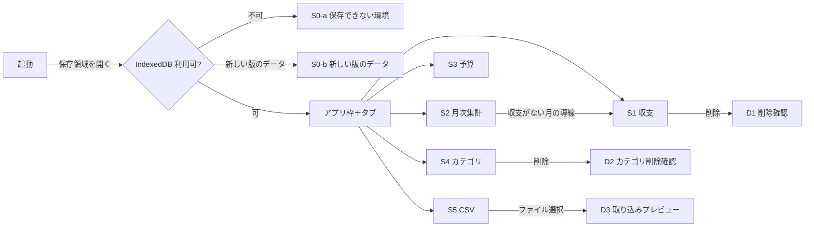

# 画面モックアップ（中〜高精細）

- 出典: `inception/user-stories/stories.md`（US1.1〜US9.3）、`inception/requirements-analysis/requirements.md`（FR1〜FR9、NFR1〜NFR9）、`refined-mockups-questions.md`（Q1〜Q6）
- ラフモックアップ（Ideation）は今回の計画に含まれないため、ストーリーと要件から直接設計した。
- 表示例の金額・メモ・日付はすべて架空の値である。
- 画面構成: 1ページのアプリで、上部のタブ5つ（収支・月次集計・予算・カテゴリ・CSV）を切り替える（Q1 = A）。

## 0. 画面構成と遷移



テキストでの説明: 起動時に保存領域を開き、使えない環境なら S0-a、アプリより新しい版のデータなら S0-b を表示して止まる。使える場合はアプリ枠と5つのタブを表示する。削除確認（D1・D2）と取り込みプレビュー（D3）はダイアログで開く。月次集計の「収支がない月」の案内から収支タブへ移れる。

## 1. 共通のアプリ枠

```
┌──────────────────────────────────────────────────────────────────────┐
│ [本文へ移動]（Tab で最初に現れるリンク。普段は非表示）              │
│ 架空データの家計簿                                  ※架空データ専用 │
│──────────────────────────────────────────────────────────────────────│
│ [ 収支 ] [ 月次集計 ] [ 予算 ] [ カテゴリ ] [ CSV ]                  │
│   ▔▔▔▔   ← 選択中のタブは下線＋太字（色だけに頼らない）           │
│──────────────────────────────────────────────────────────────────────│
│ （各タブの内容）                                                    │
└──────────────────────────────────────────────────────────────────────┘
```

- タブは左右の矢印キーで移動し、Tab キーで内容へ入る（interaction-spec.md「TabNav」）。
- ヘッダーに「※架空データ専用」と常に表示する（C2）。
- 月を扱うタブ（収支・月次集計・予算）は、同じ「対象月」を共有する。あるタブで月を変えると、他のタブでもその月が選ばれている（初期値は今月）。

## S0-a 保存できない環境（US8.4、FR8.4）

```
┌──────────────────────────────────────────────────────────────┐
│ 架空データの家計簿                                          │
│──────────────────────────────────────────────────────────────│
│ ⚠ この環境ではデータを保存できません                        │
│   ブラウザの設定（プライベートモードなど）により、          │
│   データを保存する機能が使えません。通常のウィンドウで      │
│   開き直してください。                                      │
│                                                              │
│   [ 再読み込み ]                                            │
└──────────────────────────────────────────────────────────────┘
```

- タブと入力フォームは表示しない（AC8.4.1）。メッセージは `role="alert"` で通知する。

## S0-b 新しい版のデータ（US1.2 AC1.2.3）

```
┌──────────────────────────────────────────────────────────────┐
│ ⚠ 新しい版で保存されたデータのため開けません                │
│   このブラウザのデータは、より新しい版のアプリで保存されて  │
│   います。データは変更していません。新しい版のアプリで      │
│   開いてください。                                          │
│   [ 再読み込み ]                                            │
└──────────────────────────────────────────────────────────────┘
```

## S1 収支タブ（US2.1〜US2.5、US8.1〜US8.3、US9.3）

### S1-1 通常（データあり）

```
┌──────────────────────────────────────────────────────────────────────┐
│ 収支の登録                                                          │
│ ┌──────────────────────────────────────────────────────────────────┐ │
│ │ 日付 *            種別 *                 カテゴリ *              │ │
│ │ [2026-10-16 📅]   (●)支出 ( )収入        [食費          ▼]      │ │
│ │ 金額（円・整数） *            メモ（200文字まで）                │ │
│ │ [ 1200          ]             [ 架空のランチ               ]    │ │
│ │                                                  [ 登録する ]    │ │
│ └──────────────────────────────────────────────────────────────────┘ │
│ ✓ 保存しました（5秒で消える。読み上げにも通知）                    │
│                                                                      │
│ 収支一覧   [◀ 前月]  2026年10月  [翌月 ▶]                           │
│ ┌────────┬────┬────────┬─────────┬────────────┬──────────────────┐ │
│ │日付    │種別│カテゴリ│ 金額(円)│メモ        │操作              │ │
│ ├────────┼────┼────────┼─────────┼────────────┼──────────────────┤ │
│ │10/15   │支出│交通費  │   3,000 │架空の定期代│[編集] [削除]     │ │
│ │10/01   │収入│給与    │ 250,000 │            │[編集] [削除]     │ │
│ │10/01   │支出│食費    │   1,200 │架空のランチ│[編集] [削除]     │ │
│ └────────┴────┴────────┴─────────┴────────────┴──────────────────┘ │
│ 3件                                                                  │
└──────────────────────────────────────────────────────────────────────┘
```

- 並び順は日付の新しい順 → 登録日時の新しい順 → `id` 順（AC2.3.1、AC2.3.2）。
- 金額は右寄せ・3桁区切り。種別は「支出」「収入」の文字で示す（色だけに頼らない）。
- メモ・カテゴリ名はエスケープして文字として表示する（AC2.3.3、NFR8）。長いメモは1行で省略表示し、全文は `title` ではなく行の展開ボタンで確認できる（キーボードで操作可能）。
- `*` は必須。必須の意味は「* は必須項目」と凡例を表示する。

### S1-2 編集モード（US2.4）

```
│ 収支の編集（2026-10-01 食費 1,200円）                               │
│ ┌──────────────────────────────────────────────────────────────────┐ │
│ │ 日付 [2026-10-01]  種別 (●)支出  カテゴリ [食費 ▼]              │ │
│ │ 金額 [ 1500 ]      メモ [ 架空のランチ ]                         │ │
│ │                                   [ キャンセル ] [ 変更を保存 ]  │ │
│ └──────────────────────────────────────────────────────────────────┘ │
│ 一覧の対象行に「編集中」と表示                                      │
```

- 一覧の「編集」でフォームが編集モードになり、フォーカスは日付欄に移る。キャンセルまたは保存後は、押した「編集」ボタンへフォーカスを戻す。
- 日付を別の月に変えて保存すると、その収支は現在の月の一覧から消え、「2026年11月に移動しました」と表示する（AC2.4.3）。

### S1-3 入力エラー（US2.2、US9.3）

```
│ ┌──────────────────────────────────────────────────────────────────┐ │
│ │ ⚠ 2件の項目を確認してください                                   │ │
│ │ 日付 *                                                           │ │
│ │ [2026-13-01]                                                     │ │
│ │ ⚠ 日付：存在する日付を YYYY-MM-DD で入力してください            │ │
│ │ 金額（円・整数） *                                               │ │
│ │ [ 12.5 ]                                                         │ │
│ │ ⚠ 金額：1〜99,999,999 の整数で入力してください                  │ │
│ └──────────────────────────────────────────────────────────────────┘ │
```

- エラーは項目の直下に「⚠＋項目名＋直し方」の文字で表示し、入力欄の枠も太くする（色だけに頼らない）。
- フォーカスは画面上で最初のエラー項目へ移る（AC9.3.2）。入力値はすべて残す（AC2.2.1）。

### S1-4 収支がない月（US2.3 AC2.3.4）

```
│ 収支一覧   [◀ 前月]  2026年12月  [翌月 ▶]                           │
│ ┌──────────────────────────────────────────────────────────────────┐ │
│ │ この月の収支はまだありません。                                   │ │
│ │ 上の「収支の登録」から追加できます。 [ 登録欄へ移動 ]            │ │
│ └──────────────────────────────────────────────────────────────────┘ │
```

### S1-5 読み込み中（US8.1）

```
│ 収支一覧   [◀ 前月]  2026年10月  [翌月 ▶]                           │
│ ┌──────────────────────────────────────────────────────────────────┐ │
│ │ ⏳ 読み込み中…（読み上げ: 「収支を読み込み中」）                 │ │
│ │ ▒▒▒▒▒▒▒▒▒▒▒▒▒▒▒▒▒▒ （行の形をした仮表示）                       │ │
│ └──────────────────────────────────────────────────────────────────┘ │
│ [ 登録する ]（無効）  ← 読み込み完了まで押せない                    │
│ 読み込みが終わると一覧が表示され、登録できるようになります。        │
```

- 5秒を超えても終わらない場合は「時間がかかっています。しばらく待つか、再読み込みしてください」と追記する（FR8.5 の次の操作）。

### S1-6 読み込み失敗（US8.2）

```
│ ┌──────────────────────────────────────────────────────────────────┐ │
│ │ ⚠ データを読み込めませんでした                                   │ │
│ │   保存領域からの読み込みに失敗しました。                         │ │
│ │   [ 再試行 ]                                                     │ │
│ └──────────────────────────────────────────────────────────────────┘ │
```

- 「収支はまだありません」は表示しない（AC8.2.1）。登録フォームも無効のままにする。

### S1-7 保存失敗（US8.3、US3.4 AC3.4.4）

```
│ ┌──────────────────────────────────────────────────────────────────┐ │
│ │ ⚠ 保存できませんでした。入力内容はそのまま残っています。         │ │
│ │   もう一度「登録する」を押すと再試行します。                     │ │
│ └──────────────────────────────────────────────────────────────────┘ │
│ （フォームの入力値は保持。一覧には追加しない）                      │
```

- カテゴリが別のタブで削除されていた場合は「選んだカテゴリが見つかりません。画面を更新してください」と表示し、[ 画面を更新 ] を添える（AC3.4.4）。
- 保存中は「登録する」を無効にし「保存中…」と表示する（AC2.1.4 の二重登録防止）。

### D1 削除確認ダイアログ（US2.5、US9.2）

```
        ┌───────────────────────────────────────────┐
        │ この収支を削除しますか？                 │
        │                                           │
        │ 2026-10-01　支出　食費　1,200円           │
        │ メモ：架空のランチ                        │
        │                                           │
        │ 削除すると元に戻せません。                │
        │              [ キャンセル ] [ 削除する ]  │
        └───────────────────────────────────────────┘
```

- 開いたときのフォーカスは「キャンセル」（誤操作防止）。Esc で閉じ、押した「削除」ボタンへフォーカスを戻す（AC9.2.2）。
- ダイアログ外への Tab 移動はできない（AC9.2.1）。背景のクリックでは閉じない（破壊的操作の確認のため）。

## S2 月次集計タブ（US5.1〜US5.4）

### S2-1 通常

```
┌──────────────────────────────────────────────────────────────────────┐
│ 月次集計   [◀ 前月]  2026年10月  [翌月 ▶]                           │
│ ┌──────────────┬──────────────┬──────────────────────────────┐     │
│ │ 収入合計     │ 支出合計     │ 差額                         │     │
│ │ 270,000円    │ 4,200円      │ 265,800円（黒字）            │     │
│ └──────────────┴──────────────┴──────────────────────────────┘     │
│                                                                      │
│ 支出のカテゴリ別                                                    │
│ ┌──────────┬────────────────┬─────────┬──────────┬──────────┐    │
│ │カテゴリ  │予算(円)        │実績(円) │残り(円)  │状態      │    │
│ ├──────────┼────────────────┼─────────┼──────────┼──────────┤    │
│ │食費      │ 1,000          │   1,200 │   −200   │▲ 超過    │    │
│ │交通費    │ — (予算なし)   │   3,000 │   —      │—         │    │
│ │日用品    │ 5,000 (引き継ぎ)│       0 │   5,000  │範囲内    │    │
│ ├──────────┼────────────────┼─────────┼──────────┼──────────┤    │
│ │合計      │                │   4,200 │          │          │    │
│ └──────────┴────────────────┴─────────┴──────────┴──────────┘    │
│                                                                      │
│ 収入のカテゴリ別                                                    │
│ ┌──────────┬─────────┐                                             │
│ │カテゴリ  │実績(円) │                                             │
│ │給与      │ 250,000 │                                             │
│ │副収入    │  20,000 │                                             │
│ └──────────┴─────────┘                                             │
└──────────────────────────────────────────────────────────────────────┘
```

- 支出カテゴリは全件を表示する（実績 0 円・予算なしも含む）。並び順は初期カテゴリの順 → 追加順。
- 「超過」は「▲ 超過」の記号＋文字、差額のマイナスは「−」記号＋「（赤字）」の文字で示す（AC5.1.3、AC9.1.4）。
- 引き継いだ予算は「(引き継ぎ)」と表示し、残り・超過の計算にも使う（FR4.3・FR5.3）。
- 支出の合計行の実績は支出合計と一致する（AC5.2.3）。

### S2-2 収支がない月（US5.4）

```
│ ┌──────────────┬──────────────┬──────────────┐                     │
│ │ 収入合計 0円 │ 支出合計 0円 │ 差額 0円     │                     │
│ └──────────────┴──────────────┴──────────────┘                     │
│ この月の収支はまだありません。 [ 収支タブで登録する ]               │
│ 支出のカテゴリ別（予算がある場合は予算・実績 0円・残り＝予算を表示）│
```

### S2-3 読み込み中・読み込み失敗

S1-5、S1-6 と同じ部品（StatusPanel）で表示する。合計欄は「—」とし、0円とは表示しない（空データと区別する）。

## S3 予算タブ（US4.1〜US4.3）

### S3-1 通常

```
┌──────────────────────────────────────────────────────────────────────┐
│ 予算   [◀ 前月]  2026年10月  [翌月 ▶]                               │
│ 支出カテゴリごとに、この月の予算を設定します。設定していない月は、  │
│ それより前で最も近い月の予算を引き継ぎます。                        │
│ ┌──────────┬──────────────────────────┬────────────────────────┐   │
│ │カテゴリ  │この月の予算（円・整数）  │操作                    │   │
│ ├──────────┼──────────────────────────┼────────────────────────┤   │
│ │食費      │[ 25000   ] 設定済み      │[保存] [設定を外す]     │   │
│ │日用品    │[ 5000    ] 引き継ぎ(8月) │[保存]                  │   │
│ │交通費    │[         ] 予算なし      │[保存]                  │   │
│ └──────────┴──────────────────────────┴────────────────────────┘   │
│ ✓ 食費の予算を保存しました                                          │
└──────────────────────────────────────────────────────────────────────┘
```

- 「引き継ぎ(8月)」の行の入力欄には引き継ぎ値を薄い表示ではなく通常の文字で表示し、横に「引き継ぎ(2026年8月)」と文字で示す。値を変えて保存すると、その月の設定済みになる。
- 「設定を外す」は設定済みの月にだけ表示する。外した後は引き継ぎまたは予算なしに戻る（AC4.3.1）。
- 0 を入力して保存すると「設定済み 0円」になる（AC4.3.2）。空欄で保存しようとすると「設定を外すには［設定を外す］を使ってください」と案内する。
- 入力エラー（AC4.1.2）は行の下に「⚠ 予算額：0〜99,999,999 の整数で入力してください」と表示し、その入力欄にフォーカスを移す。

## S4 カテゴリタブ（US3.1〜US3.4）

```
┌──────────────────────────────────────────────────────────────────────┐
│ カテゴリ                                                            │
│ 追加：種別 (●)支出 ( )収入  名前 [            ] [ 追加する ]        │
│                                                                      │
│ 支出カテゴリ（7件）                                                 │
│ ┌──────────────┬──────────┬───────────────────────────────┐        │
│ │名前          │使用件数  │操作                           │        │
│ ├──────────────┼──────────┼───────────────────────────────┤        │
│ │食費          │ 2件      │[名前を変更] [削除]            │        │
│ │娯楽          │ 0件      │[名前を変更] [削除]            │        │
│ └──────────────┴──────────┴───────────────────────────────┘        │
│ 収入カテゴリ（3件）                                                 │
│ │給与          │ 1件      │[名前を変更] [削除]            │        │
└──────────────────────────────────────────────────────────────────────┘
```

- 「名前を変更」でその行の名前が入力欄に変わる（[保存] [キャンセル]）。Esc で取り消し、ボタンへフォーカスを戻す。
- 使用中のカテゴリの「削除」は押せるが、押すと削除せず「2件の収支で使われているため削除できません」と行の下に表示する（AC3.4.1）。理由を伝えるため、無効化ではなく説明を返す。
- 種別の最後の1件の削除も同様に理由を表示する（AC3.4.3）。
- 名前の重複・空白のみ・21文字以上は追加欄の下にエラーを表示する（AC3.2.2、AC3.2.3、AC3.3.2）。

### D2 カテゴリ削除確認ダイアログ（US3.4 AC3.4.2）

```
        ┌───────────────────────────────────────────┐
        │ カテゴリ「娯楽」を削除しますか？         │
        │ このカテゴリの予算（2026年10月 3,000円   │
        │ ほか1件）も削除されます。                 │
        │              [ キャンセル ] [ 削除する ]  │
        └───────────────────────────────────────────┘
```

- 確定時に最新データで使用件数を再確認し、使われていた場合は削除せず理由を表示する（別のタブでの登録への備え）。

## S5 CSV タブ（US6.1〜US6.3、US7.1〜US7.4）

```
┌──────────────────────────────────────────────────────────────────────┐
│ CSV 書き出し                                                        │
│ 対象：(●)全期間  ( )月を指定 [2026-10 ▼]                            │
│ [ CSV を書き出す ]                                                  │
│ ✓ budget-transactions-20261016.csv を書き出しました（3件）          │
│   ※書き出す収支がないときは「見出し行のみ出力しました」と表示       │
│                                                                      │
│ CSV 読み込み                                                        │
│ 形式：date,type,category,amount,memo（UTF-8、1MB・5,000行まで）     │
│ [ ファイルを選ぶ ]  ← ボタン。Enter/Space でファイル選択を開く      │
│ ⚠ 見出し行の形式が違います（1行目が date,type,category,amount,memo  │
│   ではありません）                                                  │
└──────────────────────────────────────────────────────────────────────┘
```

- ファイルを選ぶと解析し、問題がなければ D3 を開く。見出し不一致・空ファイル・上限超過は D3 を開かずにこの欄へ理由を表示する（AC7.3.1〜AC7.3.3）。空ファイルは「データがありません」と表示し、失敗とは区別する。
- ファイル選択はネイティブの `<input type="file">` を視覚的に隠さず、ボタン風の見た目で実装する（キーボード・読み上げで扱える）。

### D3 取り込みプレビューダイアログ（US7.1、US7.2、US7.4、US9.2）

```
   ┌────────────────────────────────────────────────────────────────┐
   │ 取り込みの確認：example-fictional.csv                          │
   │ 取り込める行：3件　　取り込めない行：1件                       │
   │                                                                │
   │ 取り込めない行                                                 │
   │ ・3行目：金額が数値ではありません（"abc"）                     │
   │                                                                │
   │ 取り込める行                                                   │
   │ ┌────────┬────┬────────┬───────┬────────────┬──────────────┐ │
   │ │行      │日付│種別    │カテゴリ│金額(円)   │メモ          │ │
   │ │2       │10/01│支出   │食費   │1,200       │架空のランチ  │ │
   │ │4       │10/02│支出   │交通費 │3,000       │既存と同じ内容│ │
   │ └────────┴────┴────────┴───────┴────────────┴──────────────┘ │
   │                                                                │
   │                  [ キャンセル ] [ 3件を取り込む ]              │
   └────────────────────────────────────────────────────────────────┘
```

- 行番号は見出し行を1行目とした元ファイルの行番号（AC7.1.1）。
- 既存と同じ内容の行には「既存と同じ内容」と注記するが、取り込み対象からは外さない（AC7.4.1、AC7.4.2）。
- 取り込める行が0件のときは確定ボタンを無効にし「取り込める行がありません」と表示する（AC7.1.4）。
- 取り込み中は「取り込み中…」と表示しボタンを無効にする。失敗したら「取り込めませんでした。1件も追加していません」と表示し、ダイアログは開いたまま再試行できる（AC7.2.3）。
- 成功したらダイアログを閉じ、CSV タブに「3件を取り込みました」と表示する。
- CSV 由来の値（カテゴリ名・メモ・不正値の引用）はすべてエスケープして表示する（NFR8）。
- 開いたときのフォーカスは見出し（件数の要約）。Esc でキャンセルし「ファイルを選ぶ」へフォーカスを戻す（AC9.2.3）。
- 取り込めない行が多い場合はダイアログ内でスクロールし、要約に件数を必ず表示する。

## 2. 狭い画面での扱い（Q5 = A）

| 幅 | 扱い |
|----|------|
| 1024px 以上 | 上記の基準レイアウト |
| 768〜1023px | 同じ構成。表の列幅を詰め、メモ列は省略表示 |
| 768px 未満 | タブは横スクロール可能な1行。フォームの項目は1列に縦積み。表は1行を「日付・種別・カテゴリ・金額」の見出し付きカード形式で縦に積む |

## 3. ストーリーと画面の対応

| ストーリー | 画面・状態 |
|------------|------------|
| US1.1 | S1-3、S3-1、S4（入力エラー表示）、D3（不正行の理由） |
| US1.2 | S0-b、全画面（再読み込み後の表示） |
| US1.3 | 全画面（外部参照なし。design-system-mapping.md で外部資源を使わないことを定める） |
| US2.1〜US2.5 | S1-1〜S1-7、D1 |
| US3.1〜US3.4 | S4、D2、S1-7 |
| US4.1〜US4.3 | S3-1 |
| US5.1〜US5.4 | S2-1〜S2-3 |
| US6.1〜US6.3 | S5（書き出し） |
| US7.1〜US7.4 | S5（読み込み）、D3 |
| US8.1〜US8.4 | S1-5〜S1-7、S2-3、S0-a |
| US9.1〜US9.3 | 全画面。操作手順は interaction-spec.md、確認項目は accessibility-checklist.md |
