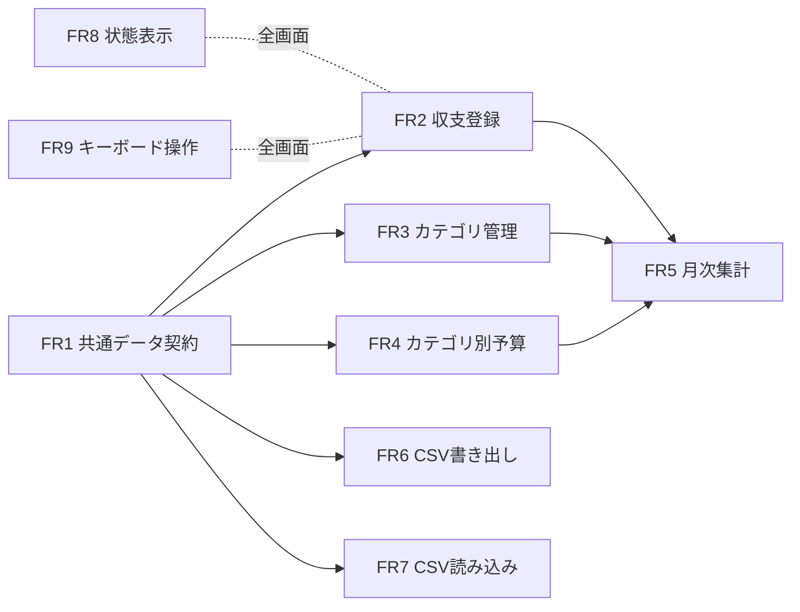

# 要件定義 — 架空データの予算管理Webアプリ

## 1. 意図の分析

- **目的**: 個人が架空の収支データを使って、日々の収支を記録し、カテゴリ別の予算と実績を月ごとに確認し、CSV でデータを持ち出し・持ち込みできる Web アプリを作る。[desc]
- **位置づけ**: AI-DLC の公式直列実行による比較用ベースラインの題材。同じ要件を、後で別の環境で D による並列化・モデル切替・Clef と比べるため、要件は実行方式に依存しない形で書く。[desc]
- **利用形態**: 1人の利用者が自分のブラウザで使う単一利用者・ローカル完結のアプリ。認証、複数利用者、テナント分離は不要。[desc] [Q1] [assumption]
- **成功の判断基準**: 第6章の機能要件の受け入れ条件と第7章の非機能要件を、マージ前検証コマンド（lint・型チェック・テスト・行カバレッジ80%）で自動確認でき、すべて通ること。[memory:team.md Testing Posture]
- **依頼の種別と複雑さ**: 新規開発、複数コンポーネント（データ契約・永続化・画面4種・CSV変換）、標準的な複雑さ。深さは Standard。

## 2. 用語

| 用語 | 意味 |
|------|------|
| 収支（取引） | 1件の収入または支出の記録。日付・種別・カテゴリ・金額・メモを持つ |
| 種別 | `income`（収入）または `expense`（支出） |
| カテゴリ | 収支の分類。種別ごとに持つ（例：支出「食費」、収入「給与」） |
| 予算 | 支出カテゴリごと・月ごとに設定する上限額 |
| 対象月 | `YYYY-MM` 形式の暦月。日付の境界は利用者のブラウザのローカルタイムゾーンで判定する |
| 共通データ契約 | 全 Unit が共有する型定義・検証規則・CSV 形式・保存形式の取り決め（FR1） |

## 3. 前提とする決定（質問への回答）

| 質問 | 決定 |
|------|------|
| Q1 保存先 | ブラウザの IndexedDB に非同期で保存する |
| Q2 金額 | 日本円のみ、1円単位の整数 |
| Q3 カテゴリ | 初期カテゴリを用意し、利用者が追加・名前変更・削除できる。使用中のカテゴリは削除不可 |
| Q4 予算 | 支出カテゴリごとに月別に設定。未設定の月は、直前に設定した月の額を引き継ぐ |
| Q5 編集・削除 | 一覧から編集・削除できる。削除は確認あり |
| Q6 月次集計 | 収入合計・支出合計・差額と、カテゴリ別の予算・実績・残り・超過の表 |
| Q7 CSV 読み込み | 取り込み前にプレビューし、正しい行だけ取り込む。不正な行は行番号と理由を表示 |
| Q8 画面技術 | React ＋ Vite（TypeScript） |

## 4. 制約

- **C1** アプリケーションは TypeScript で実装する。[desc] [memory:project.md Mandated]
- **C2** アプリ・テスト・サンプル・CSV 例に使うデータはすべて架空（合成）データとする。実在の個人・口座・取引に由来するデータを含めない。[desc] [memory:project.md Mandated/Forbidden]
- **C3** 実在の銀行口座・金融サービスとの連携機能を実装しない。[desc] [memory:project.md Forbidden]
- **C4** アプリのデータを外部のサーバー・サービスへ送信しない。[desc] [memory:project.md Forbidden]
- **C5** デプロイは行わず、ローカルでビルド・起動して確認できる状態をゴールとする。[memory:team.md Deployment]
- **C6** Prettier ＋ ESLint（TypeScript 対応）＋ TypeScript `strict` を使い、失敗した場合はマージしない。[memory:team.md Code Style]
- **C7** 画面は React ＋ Vite で作る。[Q8]
- **C8** 共通データ契約（FR1）を最初に定め、他の機能はこれに依存する形で進める。[desc] [memory:team.md Way of Working]

## 5. 機能要件の全体像

テキストでの説明: FR1（共通データ契約）を土台に、FR2 収支登録・FR3 カテゴリ管理・FR4 予算・FR6 CSV 書き出し・FR7 CSV 読み込みが成り立つ。FR5 月次集計は FR2・FR3・FR4 のデータを読む。FR8 状態表示と FR9 キーボード操作はすべての画面に横断的にかかる。

## 6. 機能要件

### FR1 共通データ契約

全機能が共有するデータの形と検証規則を、1か所の TypeScript モジュールとして定める。[desc] [Q1] [Q2]

- **FR1.1 収支（Transaction）**: `id`（アプリ生成の一意な文字列）、`date`（`YYYY-MM-DD`、実在する暦日）、`type`（`income` / `expense`）、`categoryId`、`amount`（1〜99,999,999 の整数、単位は円）、`memo`（0〜200文字、前後の空白は保存時に除去）、`createdAt`・`updatedAt`（ISO 8601、オフセット付き）を持つ。
- **FR1.2 カテゴリ（Category）**: `id`、`type`（`income` / `expense`）、`name`（前後の空白を除いて1〜20文字）、`createdAt` を持つ。同じ種別の中で名前は重複しない（前後空白を除き、英字の大文字小文字と全角半角を区別せずに比較する）。
- **FR1.3 予算（Budget）**: `categoryId`（支出カテゴリのみ）、`month`（`YYYY-MM`）、`amount`（0〜99,999,999 の整数）を持つ。1つのカテゴリ・月の組につき最大1件。
- **FR1.4 検証関数**: 各エンティティの入力値を検証し、項目名と理由を含むエラー一覧を返す関数を提供する。画面入力と CSV 読み込みは同じ検証関数を使う。
- **FR1.5 CSV 形式**: 列は `date,type,category,amount,memo` の順で、1行目は見出し行。文字コードは UTF-8（読み込み時は BOM の有無どちらも受け付け、書き出し時は BOM 付き）。改行は書き出し時 CRLF、読み込み時は CRLF・LF のどちらも受け付ける。値にカンマ・ダブルクォート・改行を含む場合は RFC 4180 に従いダブルクォートで囲む。`type` は `income` / `expense`、`category` はカテゴリ名。
- **FR1.6 保存形式のバージョン**: IndexedDB のデータベースにスキーマバージョンを持たせ、将来の形式変更時に既存データを読める状態を保つ。

**受け入れ条件**
- **AC-FR1-1** Given 日付 `2026-02-30` の収支, When 検証する, Then 「日付」が不正という理由のエラーが返る。
- **AC-FR1-2** Given 金額 `0`・`-1`・`1.5`・`100000000` の収支, When 検証する, Then いずれも「金額」のエラーになる。Given 金額 `1` と `99999999`, Then エラーにならない。
- **AC-FR1-3** Given 支出カテゴリ「食費」が存在する, When 同じ種別に「 食費 」を登録しようとする, Then 名前の重複エラーになる。Given 収入カテゴリに「食費」を登録しようとする, Then エラーにならない。
- **AC-FR1-4** Given メモに `,` `"` 改行を含む収支, When CSV に書き出して読み戻す, Then メモは元と完全に一致する。

### FR2 収支登録

[desc] [Q5]

- **FR2.1** 利用者は日付・種別・カテゴリ・金額・メモを入力して収支を登録できる。日付の初期値は今日、種別の初期値は支出。カテゴリの選択肢は選んだ種別のカテゴリのみ。
- **FR2.2** 入力が不正な場合は保存せず、不正な項目ごとに項目名と直し方を表示し、利用者が入力した値をすべて残す。
- **FR2.3** 選んだ対象月の収支を一覧で表示する。並び順は日付の新しい順、同じ日付は登録日時の新しい順、さらに同じなら `id` 順。
- **FR2.4** 一覧の収支を選んで編集し保存できる。検証は FR2.2 と同じ。
- **FR2.5** 一覧の収支を削除できる。削除前に、対象の日付・カテゴリ・金額を示した確認を表示し、確定した場合のみ削除する。
- **FR2.6** 保存ボタンの連続操作や Enter キーの連打で、同じ収支が2件以上作られない（保存処理中は送信を受け付けない）。

**受け入れ条件**
- **AC-FR2-1** Given 空の状態, When 架空の収支（2026-10-01、支出、食費、1,200円、「架空のランチ」）を登録する, Then 10月の一覧に1件表示される。
- **AC-FR2-2** Given 金額欄が空, When 保存する, Then 「金額を入力してください」と表示され、他の入力値は消えない。
- **AC-FR2-3** Given 登録済みの収支, When 金額を 1,500 円に編集して保存する, Then 一覧と月次集計の値が 1,500 円になる。
- **AC-FR2-4** Given 削除確認を表示した状態, When キャンセルする, Then 収支は削除されない。
- **AC-FR2-5** Given 保存処理中, When 保存操作をもう一度行う, Then 収支は1件だけ作られる。

### FR3 カテゴリ管理

[Q3]

- **FR3.1** 初回起動時（カテゴリが1件もないとき）に、架空の初期カテゴリを作る。支出：食費、日用品、住居費、水道光熱費、交通費、娯楽、その他支出。収入：給与、副収入、その他収入。
- **FR3.2** 利用者は種別を選んでカテゴリを追加できる。名前の規則は FR1.2 に従う。
- **FR3.3** 利用者はカテゴリの名前を変更できる。変更は既存の収支・予算の表示に反映される（`categoryId` で参照しているため）。
- **FR3.4** 収支から1件でも参照されているカテゴリは削除できず、理由（使用件数）を表示する。参照のない支出カテゴリを削除すると、そのカテゴリの予算も削除する（削除前の確認でその旨を示す）。
- **FR3.5** 各種別に最低1件のカテゴリが残る（最後の1件は削除できない）。

**受け入れ条件**
- **AC-FR3-1** Given 初回起動, When カテゴリ一覧を開く, Then 支出7件・収入3件の初期カテゴリが表示される。
- **AC-FR3-2** Given 「食費」を使う収支が2件ある, When 「食費」を削除しようとする, Then 削除されず「2件の収支で使われています」と表示される。
- **AC-FR3-3** Given 「娯楽」を「趣味」に名前変更する, When 一覧と月次集計を見る, Then 既存の収支のカテゴリ表示が「趣味」になる。

### FR4 カテゴリ別予算

[Q4]

- **FR4.1** 利用者は対象月と支出カテゴリを選び、予算額（0〜99,999,999 円の整数）を設定・変更できる。
- **FR4.2** 利用者は特定の月の予算設定を解除できる。「未設定」と「0円」は区別する。
- **FR4.3** ある月にそのカテゴリの予算が設定されていない場合、その月より前で最も近い設定済みの月の額を「引き継ぎ」としてその月の予算に使う。前に設定済みの月がなければ「予算なし」とする。引き継いだ値は画面上で「引き継ぎ」と分かるように表示する。
- **FR4.4** ある月の予算を変更しても、それより前の月の予算は変わらない。後の月のうち、その月の値を引き継いでいた月は新しい値を引き継ぐ。

**受け入れ条件**
- **AC-FR4-1** Given 食費の予算が 2026-08 に 30,000 円、2026-10 に 25,000 円で設定されている, When 2026-09 と 2026-11 の予算を見る, Then 2026-09 は 30,000 円（引き継ぎ）、2026-11 は 25,000 円（引き継ぎ）になる。
- **AC-FR4-2** Given 食費に一度も予算を設定していない, When 任意の月を見る, Then 「予算なし」と表示される。
- **AC-FR4-3** Given 2026-10 に 0 円を設定, When 2026-10 を見る, Then 予算 0 円として扱われ、支出があれば超過と表示される。
- **AC-FR4-4** Given 予算額に `-1` や `12.5` を入力, When 保存する, Then 保存されず予算額のエラーが表示される。

### FR5 月次集計

[desc] [Q6]

- **FR5.1** 利用者は対象月を選べる（初期値は今月）。前月・翌月への移動もできる。
- **FR5.2** 対象月の収入合計・支出合計・差額（収入合計 − 支出合計）を表示する。差額がマイナスのときは記号と文字でも分かるように表示する（色だけに頼らない）。
- **FR5.3** 支出カテゴリごとに「予算・実績・残り（予算 − 実績）・超過の有無」を表で表示する。予算なしのカテゴリは予算・残りを「—（予算なし）」と表示し、超過判定を行わない。
- **FR5.4** カテゴリ別の実績の合計は支出合計と一致する。
- **FR5.5** 対象月に収支が1件もない場合は、合計を 0 円と表示したうえで「この月の収支はまだありません」と表示し、登録画面への導線を示す。
- **FR5.6** 収入カテゴリごとの実績も表で表示する（予算は持たない）。

**受け入れ条件**
- **AC-FR5-1** Given 2026-10 に収入 250,000 円（給与）、支出 1,200 円（食費）と 3,000 円（交通費）, When 2026-10 の集計を見る, Then 収入合計 250,000、支出合計 4,200、差額 245,800 と表示される。
- **AC-FR5-2** Given 食費の予算 1,000 円、実績 1,200 円, When 集計を見る, Then 残り −200 円で「超過」と文字で表示される。
- **AC-FR5-3** Given 収支のない月, When 集計を見る, Then 合計はすべて 0 円で、収支がない旨のメッセージが表示される。
- **AC-FR5-4** Given 9月30日と10月1日の収支, When 10月の集計を見る, Then 10月1日の分だけが含まれる。

### FR6 CSV 書き出し

[desc]

- **FR6.1** 利用者は全期間または指定した対象月の収支を、FR1.5 の形式の CSV ファイルとして書き出せる。ファイル名は `budget-transactions-YYYYMMDD.csv`（全期間）または `budget-transactions-YYYY-MM.csv`（月指定）。
- **FR6.2** 書き出しはブラウザ内でファイルを生成してダウンロードさせる方式とし、ネットワーク送信を行わない。
- **FR6.3** 表計算ソフトで開いたときに数式として実行されないよう、`=` `+` `-` `@` で始まるメモの先頭にはシングルクォートを付けて書き出す。読み込み時は、先頭がシングルクォートで2文字目が `=` `+` `-` `@` のメモに限り、先頭のシングルクォートを取り除く。
- **FR6.4** 書き出し対象の収支が0件の場合は、見出し行のみのファイルを作り、「書き出す収支がないため見出し行のみ出力しました」と表示する。

**受け入れ条件**
- **AC-FR6-1** Given 3件の収支, When 全期間を書き出す, Then 見出し行＋3行の CSV ができ、日付の古い順に並ぶ。
- **AC-FR6-2** Given メモ `=SUM(A1)` の収支, When 書き出す, Then メモ列は `'=SUM(A1)` になる。読み込み直すと `=SUM(A1)` に戻る。
- **AC-FR6-3** Given 書き出し中にネットワーク呼び出しを監視する, When 書き出す, Then ネットワーク要求は発生しない。

### FR7 CSV 読み込み

[desc] [Q7]

- **FR7.1** 利用者は CSV ファイルを選ぶ（ファイル選択ダイアログ。キーボードで操作できること）。
- **FR7.2** 読み込んだ内容を取り込む前にプレビューとして表示する。プレビューには、取り込める行の件数と内容、取り込めない行の行番号（見出し行を1行目とした元ファイルの行番号）と理由を表示する。
- **FR7.3** 行の検証は FR1.4 の検証関数を使う。カテゴリ名が存在しない行、種別とカテゴリの種別が一致しない行は取り込めない行とする。
- **FR7.4** 利用者がプレビューで確定した場合のみ、取り込める行だけを新しい収支として一括で追加する。追加は1回の保存処理で行い、途中で失敗した場合は1件も追加しない。キャンセルした場合は何も変わらない。
- **FR7.5** 見出し行が FR1.5 と一致しない、または取り込める行も取り込めない行もない（見出し行のみ・空ファイル）場合は、プレビューに進まず理由を表示する。空ファイルは「データがありません」と表示し、読み込みの失敗とは区別する。
- **FR7.6** ファイルサイズ 1MB 超、または見出しを除き 5,000 行を超えるファイルは読み込まず、上限を表示する。
- **FR7.7** 既存の収支と同じ内容の行も新しい収支として追加する（重複判定は行わない）。プレビューで、既存の収支と日付・種別・カテゴリ・金額・メモがすべて一致する行には「既存と同じ内容」と注記する。

**受け入れ条件**
- **AC-FR7-1** Given 正しい行3件と、金額が `abc` の行（3行目）を含む CSV, When 読み込む, Then プレビューに取り込める行3件と「3行目：金額が数値ではありません」が表示される。
- **AC-FR7-2** Given プレビュー表示中, When 確定する, Then 3件だけが追加され、月次集計に反映される。
- **AC-FR7-3** Given プレビュー表示中, When キャンセルする, Then 収支は1件も増えない。
- **AC-FR7-4** Given 見出し行が `日付,金額` の CSV, When 読み込む, Then 「見出し行の形式が違います」と表示され、プレビューに進まない。
- **AC-FR7-5** Given FR6 で書き出した CSV, When 空の状態のアプリに読み込む, Then 書き出し元と同じ内容の収支が再現される（`id` と登録日時は新しく付与される）。

### FR8 状態表示（読み込み中・空データ・保存失敗）

[desc]

- **FR8.1** 保存領域からデータを読み込んでいる間は、各画面に「読み込み中」を表示し、操作ボタンを無効にする。読み込み中の表示は、スクリーンリーダーにも伝わるよう状態として通知する。
- **FR8.2** 読み込みに失敗した場合は「データを読み込めませんでした」と理由の概要を表示し、「再試行」操作を示す。空データの表示とは区別する。
- **FR8.3** 保存（登録・編集・削除・カテゴリ・予算・CSV 取り込み）に失敗した場合は、失敗したことと再試行の方法を表示し、利用者の入力内容を残す。画面上の表示は保存に成功したデータのみを反映する（失敗した変更を成功したように見せない）。
- **FR8.4** ブラウザが IndexedDB を使えない場合（プライベートモードの制限など）は、起動時に「この環境ではデータを保存できません」と表示する。
- **FR8.5** 空データ・読み込み中・エラーはそれぞれ異なる表示とし、次に取れる操作を示す。

**受け入れ条件**
- **AC-FR8-1** Given 保存処理が失敗するよう差し替えた保存領域, When 収支を登録する, Then 「保存できませんでした」と再試行の案内が表示され、入力値が残り、一覧には追加されない。
- **AC-FR8-2** Given 読み込みが完了していない, When 画面を表示する, Then 「読み込み中」が表示され、保存ボタンは押せない。
- **AC-FR8-3** Given 読み込みが失敗するよう差し替えた保存領域, When 画面を開く, Then 読み込み失敗の表示と「再試行」が表示され、「収支はまだありません」とは表示されない。

### FR9 キーボード操作

[desc]

- **FR9.1** すべての機能（画面の切り替え、登録、編集、削除、カテゴリ・予算の操作、月の移動、CSV の書き出し・読み込み・確定・キャンセル）をキーボードだけで操作できる。
- **FR9.2** フォーカス位置が常に目で見て分かる。Tab キーの移動順は画面上の読み順と一致する。
- **FR9.3** 確認ダイアログやプレビューを開くとフォーカスがその中に移り、Esc キーで閉じられる。閉じた後は開く前の操作要素にフォーカスが戻る。ダイアログ表示中は背後の要素にフォーカスが移らない。
- **FR9.4** 入力フォームは Enter キーで送信できる。入力エラー時は最初のエラー項目にフォーカスを移す。

**受け入れ条件**
- **AC-FR9-1** Given マウスを使わない, When Tab・Shift+Tab・Enter・Space・Esc・矢印キーだけで収支を1件登録して削除する, Then 両方の操作が完了する。
- **AC-FR9-2** Given 削除確認ダイアログを開いた, When Esc を押す, Then ダイアログが閉じ、削除ボタンにフォーカスが戻る。
- **AC-FR9-3** Given 金額が不正なまま送信する, When エラーが表示される, Then フォーカスが金額欄に移る。

## 7. 非機能要件

- **NFR1 外部送信なし**: アプリは実行時に、アプリ自身の配信元以外へのネットワーク要求を一切行わない（解析・フォント・CDN を含む）。自動テストで、利用者操作の全シナリオ中に外部へのネットワーク要求が0件であることを確認する。[desc] [memory:project.md Forbidden]
- **NFR2 アクセシビリティ**: WCAG 2.1 レベル AA のうち、キーボード操作（2.1.1、2.1.2）、フォーカス順序と可視性（2.4.3、2.4.7）、エラーの特定と説明（3.3.1、3.3.3）、色だけに頼らない表示（1.4.1）、コントラスト比 4.5:1 以上（1.4.3）を満たす。自動のアクセシビリティ検査で違反0件とする。[desc] [assumption]
- **NFR3 性能**: 架空の収支 5,000 件・カテゴリ 30 件・予算 360 件を保存した状態で、開発用 PC の最新版 Chrome において、月次集計の表示切り替えが 500ms 以内、CSV 5,000 行の読み込みからプレビュー表示までが 2 秒以内に完了する。[assumption]
- **NFR4 データの整合性**: 1回の保存操作（CSV 一括取り込みを含む）は全部成功するか全部失敗するかのどちらかとする。保存に失敗しても、それ以前に保存済みのデータは失われない。[desc] [Q7]
- **NFR5 金額計算**: 金額は整数で扱い、浮動小数点の誤差が出ない。集計値はすべて整数円で、表示は3桁区切り。[Q2]
- **NFR6 品質**: 行カバレッジ 80% 以上。lint・型チェック・テスト・カバレッジを1つのローカルコマンドで実行でき、マージ前に必ず成功させる。入力エラー・空データ・読み込み中・保存失敗・キーボード操作の観点をテストに含める。[memory:team.md Testing Posture]
- **NFR7 対応ブラウザ**: デスクトップ版の最新の Chrome、Edge、Firefox、Safari。対応外のブラウザで IndexedDB が使えない場合は FR8.4 の表示を行う。[assumption]
- **NFR8 安全な表示**: 利用者の入力（メモ・カテゴリ名・CSV の値）は画面に表示するとき必ずエスケープし、HTML やスクリプトとして解釈されない。CSV 書き出しは FR6.3 の数式対策を行う。[desc] [assumption]
- **NFR9 再現性**: クリーンな取得状態から、記載した手順（依存のインストール、検証コマンド、起動）だけでビルド・テスト・起動ができる。依存のバージョンはロックファイルで固定する。[memory:team.md Deployment]

## 8. 想定（Assumptions）

- **A1** 利用者は1人で、自分のブラウザだけで使う。そのため認証・権限・複数利用者の同時編集は扱わない。同じブラウザで複数タブを開いた場合は、各タブが保存時点の最新データに対して保存し、他のタブの変更は再読み込みで反映される（リアルタイム同期はしない）。[assumption]
- **A2** 日付の境界は利用者のブラウザのローカルタイムゾーンで判定する。収支の日付は時刻を持たない暦日として扱うため、タイムゾーンをまたいでも日付は変わらない。[assumption]
- **A3** 初期状態ではカテゴリ（FR3.1）以外のデータは空とする。架空のサンプル収支を読み込む機能は作らない（動作確認とテストは、テスト用の架空データファイルで行う）。[assumption]
- **A4** 金額の上限 99,999,999 円、メモ 200 文字、カテゴリ名 20 文字、CSV 1MB・5,000 行は、個人の家計で十分な余裕を持つ値として置いた。[assumption]
- **A5** CSV 読み込みは追加のみとし、既存データの置き換えや削除は行わない。[Q7] [assumption]
- **A6** 予算は支出カテゴリにのみ設定する。収入カテゴリは実績表示のみとする。[Q4] [assumption]

## 9. 対象外（Out of scope）

- 実在の銀行口座・クレジットカード・金融サービスとの連携、外部 API の利用 [desc]
- サーバー側の処理、クラウド保存、複数端末間の同期、ログイン [desc] [Q1]
- 公開・デプロイ（ローカル起動のみ） [memory:team.md Deployment]
- 複数通貨、為替換算 [Q2]
- 繰り返し収支（毎月自動登録）、通知、グラフ表示 [Q6]
- 収支の検索・絞り込み（対象月での表示を除く）
- CSV 以外の形式（Excel、JSON、PDF）での入出力
- スマートフォン向けの専用画面（レスポンシブ対応は最低限のみ）

## 10. 未解決の事項（後続の工程で決める）

- **OQ1** テストランナーと E2E テストの道具（例：Vitest、Testing Library、Playwright）は設計段階で決める。[memory:team.md Testing Posture]
- **OQ2** 画面の構成（タブ式か、ページ遷移か）と画面遷移は、画面設計で決める。
- **OQ3** IndexedDB の操作に補助ライブラリを使うかどうかは設計段階で決める。
- **OQ4** 共通データ契約（FR1）と他機能の Unit 分割・依存関係は、Units Generation で整理する。

## Sources

- `Initial description:` [desc] — `project-description.json` に保存された依頼文（架空データのみ、収支登録・カテゴリ別予算・月次集計・CSV 入出力、TypeScript、実口座連携・外部送信なし、入力エラー・空データ・読み込み中・保存失敗・キーボード操作、共通データ契約を先に定める、承認・レビュー・テストを省略しない）
- `Workflow-selected scope:` [scope] — classic（Standard 深さ、Standard テスト戦略）
- [Q1]〜[Q8] — `requirements-analysis-questions.md` の回答
- [memory:team.md] — `aidlc/spaces/default/memory/team.md`（Practices Discovery で確定した Way of Working、Testing Posture、Deployment、Code Style）
- [memory:project.md] — `aidlc/spaces/default/memory/project.md`（Mandated 3件、Forbidden 3件）
- 上流成果物 — `inception/practices-discovery/team-practices.md`
- [assumption] — 上記から直接は決まらず、要件を検証可能にするために置いた値。第8章で理由を示し、承認時に修正できる

## Assumptions & Open Questions

- 想定は第8章 A1〜A6、および NFR2・NFR3・NFR7・NFR8 の数値・範囲に [assumption] として示した。
- 未解決の事項は第10章 OQ1〜OQ4 に示した。いずれも後続の設計工程で決めるもので、この要件の受け入れ条件には影響しない。
