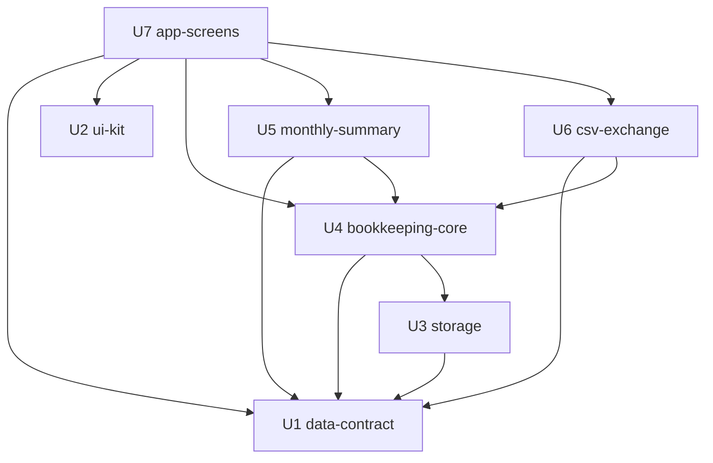

# Unit の依存関係

- 出典: `unit-of-work.md`、`inception/domain-design/components.md`（部品の depends_on）
- この文書は依存の形（トポロジー）だけを示す。どの順で作るか、どこを先に出すかは Delivery Planning で決める。
- 依存の向き: 「A が B に依存する」＝ A は B の公開窓口を使う。B の約束が決まっていれば、A は B の差し替え（テスト用の偽物）を使って並べて進めることもできるが、ここでは実際のコードの依存として記す。

## 1. 依存グラフ



テキストでの説明: U1（共通データ契約）と U2（画面部品）はどこにも依存しない。U3（保存）は U1 に依存する。U4（家計簿の中核）は U1 と U3 に依存する。U5（月次集計）と U6（CSV 入出力）はそれぞれ U1 と U4 に依存し、互いには依存しない。U7（画面）は U1・U2・U4・U5・U6 に依存する。循環はない。

## 2. 依存の一覧（機械可読）

```yaml
units:
  - name: data-contract
    kind: spec
    depends_on: []
  - name: ui-kit
    kind: library
    depends_on: []
  - name: storage
    kind: library
    depends_on: [data-contract]
  - name: bookkeeping-core
    kind: library
    depends_on: [data-contract, storage]
  - name: monthly-summary
    kind: library
    depends_on: [data-contract, bookkeeping-core]
  - name: csv-exchange
    kind: library
    depends_on: [data-contract, bookkeeping-core]
  - name: app-screens
    kind: ui
    depends_on: [data-contract, ui-kit, bookkeeping-core, monthly-summary, csv-exchange]
```

## 3. Unit 間のつながり（統合点）

すべて同じアプリ内の TypeScript の関数呼び出しと型の共有で、ネットワーク・イベント・共有の保存領域の直接操作はない。具体的な関数の形は Contract Design で決める。

| 依存する Unit | 依存される Unit | つながりの内容 | 種類 |
|---------------|-----------------|----------------|------|
| U3 storage | U1 data-contract | 保存スキーマの版番号、保存する形（型） | 型・定数の共有 |
| U4 bookkeeping-core | U1 data-contract | 収支・カテゴリ・予算の型、検証関数、検証エラーの形 | 関数呼び出し・型の共有 |
| U4 bookkeeping-core | U3 storage | 1回の書き込み処理の開始と確定、保存領域の読み書き、失敗の種類 | 関数呼び出し |
| U5 monthly-summary | U1 data-contract | 日付から対象月を得る関数、型 | 関数呼び出し・型の共有 |
| U5 monthly-summary | U4 bookkeeping-core | 対象月の収支、カテゴリ一覧、その月に使う予算と出所 | 関数呼び出し |
| U6 csv-exchange | U1 data-contract | CSV 行の符号化・復号、行の検証 | 関数呼び出し |
| U6 csv-exchange | U4 bookkeeping-core | 書き出す収支の取得、カテゴリ名の照合、既存と同じ内容の判定、一括追加 | 関数呼び出し |
| U7 app-screens | U1 data-contract | 検証エラーの文言、型 | 関数呼び出し・型の共有 |
| U7 app-screens | U2 ui-kit | 画面の部品とデザイントークン | React 部品の利用 |
| U7 app-screens | U4 bookkeeping-core | すべての書き込み操作、一覧・選択肢・予算の行の取得 | 関数呼び出し |
| U7 app-screens | U5 monthly-summary | 月次集計の取得 | 関数呼び出し |
| U7 app-screens | U6 csv-exchange | 書き出し、取り込みプレビューの作成と確定 | 関数呼び出し |

- 起動時の保存領域の状態（利用不可・新しい版）を U7 へ渡す経路は、Domain Design のレビューで受け入れた指摘として、Contract Design で決める（U3 の状態を U4 を経由して渡すか、U7 が U3 を直接参照するか）。直接参照に決まった場合は、この表と上の依存一覧に U7 → U3 を追加する。

## 4. 並べて進められる組み合わせ

依存のない Unit 同士は、依存の順序を守るかぎり同時に進められる。トポロジーとして成り立つ順序は複数ある。

| 並べて進められる組 | 条件 |
|--------------------|------|
| U1 と U2 | どちらも依存がない |
| U2 と U3 | U3 は U1 のみに依存し、U2 とは無関係 |
| U2 と U4 | U4 は U1・U3 に依存し、U2 とは無関係 |
| U5 と U6 | どちらも U1・U4 に依存し、互いには依存しない |
| U2 と U5、U2 と U6 | U2 は U5・U6 と無関係 |

- U7 はすべての Unit に（直接または間接に）依存するため、ほかの Unit と同時には完了できない。ただし U2 の部品だけを使う画面の骨組みは、約束（Contract Design）に基づく差し替えを使えば先に作り始めることができる。
- ウォーキングスケルトン（最初に端から端まで動く一本道を作ること）は採らない（team.md Walking Skeleton、skeleton: off）。そのため最初の Unit を統合スライスにする必要はない。
