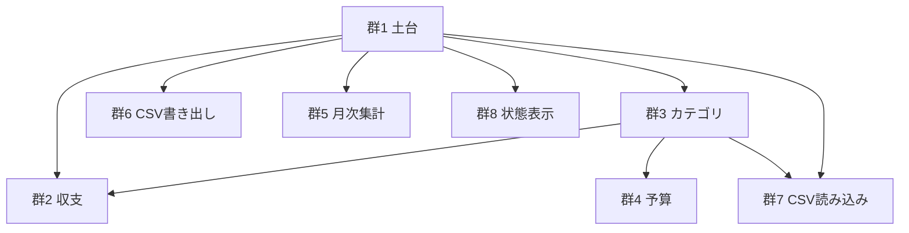

# ユーザーストーリー

- 出典: `inception/requirements-analysis/requirements.md`（FR1〜FR9、NFR1〜NFR9）、`user-stories-questions.md`（Q1〜Q4）、`personas.md`（P1、P2）
- 分け方: 機能領域ごと（Q2 = A）。粒度: 利用者の操作1つにつき1ストーリー（Q3 = A）
- 優先度: ご依頼の4機能（収支登録・カテゴリ別予算・月次集計・CSV 入出力）と明示された観点（入力エラー・空データ・読み込み中・保存失敗・キーボード操作）に関わるものは Must、補助機能は Should（Q4 = A）
- 書式: 「〔ペルソナ〕として、〔したいこと〕。それは〔価値〕のためだ。」。受け入れ条件は Given/When/Then
- テストデータ: すべて架空。例の金額・メモ・日付は架空の値である

## 群の一覧と依存関係

| 群 | 領域 | 主な要件 | 依存する群 |
|----|------|----------|------------|
| 1 | 土台（共通データ契約・保存・外部送信なし） | FR1、NFR1、NFR4 | なし |
| 2 | 収支 | FR2 | 1、3（カテゴリの選択肢） |
| 3 | カテゴリ | FR3 | 1 |
| 4 | 予算 | FR4 | 1、3 |
| 5 | 月次集計 | FR5 | 1（データ）。表示内容は 2・3・4 のデータを読む |
| 6 | CSV 書き出し | FR6 | 1 |
| 7 | CSV 読み込み | FR7 | 1、3（カテゴリ名の照合） |
| 8 | 状態表示 | FR8 | 1。全画面に横断的にかかる |
| 9 | キーボード操作 | FR9、NFR2 | 全画面に横断的にかかる |

テキストでの説明: 群1（土台）がすべての前提になる。群3（カテゴリ）は群2・群4・群7の前提。群5（月次集計）は群1のデータ契約だけに依存し、群2・3・4 で作られたデータを読む。群8と群9はすべての画面に横断的にかかる。各ストーリーはテスト用の架空データを直接用意すれば単独でテストできる（INVEST の I）。

---

## 群1 土台

### US1.1 どの画面でも同じ規則で入力が検証される

- **ストーリー**: P1 として、画面から入力しても CSV から読み込んでも同じ規則で値が確かめられてほしい。それは、どこから入れたデータでも集計を信用できるようにするためだ。
- **優先度**: Must
- **要件**: FR1.1、FR1.2、FR1.3、FR1.4、FR1.5、NFR5
- **受け入れ条件**
  - **AC1.1.1** Given 日付 `2026-02-30` の収支データ, When 共通の検証関数で検証する, Then 「日付」が不正という理由のエラーが返る。
  - **AC1.1.2** Given 金額 `0`・`-1`・`1.5`・`100000000` の収支データ, When 検証する, Then いずれも「金額」のエラーになる。Given 金額 `1` と `99999999`, Then エラーにならない。
  - **AC1.1.3** Given 支出カテゴリ「食費」がある, When 支出カテゴリ「 食費 」を検証する, Then 名前の重複エラーになる。Given 収入カテゴリ「食費」, Then エラーにならない。
  - **AC1.1.4** Given メモ 201 文字の収支データ, When 検証する, Then 「メモ」のエラーになる。Given 200 文字, Then エラーにならない。
  - **AC1.1.5** Given 予算額 `0` と `99999999`, When 検証する, Then エラーにならない。Given `-1`・`12.5`, Then 「予算額」のエラーになる。
- **INVEST**: 画面に依存しない純粋な関数として単独でテストできる。

### US1.2 入力したデータが次に開いたときも残っている

- **ストーリー**: P1 として、登録したデータがブラウザを閉じても残っていてほしい。それは、毎日少しずつ記録を積み上げるためだ。
- **優先度**: Must
- **要件**: FR1.6、NFR4
- **受け入れ条件**
  - **AC1.2.1** Given 架空の収支1件・予算1件を保存した, When ページを再読み込みする, Then 同じ収支と予算が表示される。
  - **AC1.2.2** Given 1回の保存操作で複数のデータを書き込む処理, When 途中で書き込みが失敗する, Then どのデータも書き込まれず、それ以前に保存済みのデータは残る。
  - **AC1.2.3** Given 保存領域にスキーマバージョンが記録されている, When アプリを起動する, Then 現在のバージョンのデータとして読み込まれる。Given アプリより新しいバージョンのデータ（別のタブで新しい版が開かれた場合など）, When 起動する, Then データを書き換えず「新しい版で保存されたデータのため開けません」と表示する。
- **INVEST**: 保存領域の層だけを対象にテストできる。

### US1.3 自分のデータが外部へ送られない

- **ストーリー**: P1 として、記録した家計のデータがどこにも送信されないと確信したい。それは、安心して記録を続けるためだ。
- **優先度**: Must
- **要件**: NFR1、FR6.2
- **受け入れ条件**
  - **AC1.3.1** Given ネットワーク要求を監視した状態, When 登録・編集・削除・予算設定・集計表示・CSV 書き出し・CSV 読み込みの一連の操作を行う, Then アプリの配信元以外への要求は0件である。
  - **AC1.3.2** Given アプリのビルド成果物, When 外部ドメインへの参照（解析タグ、外部フォント、CDN）を検査する, Then 0件である。
- **INVEST**: 画面操作の自動テストとビルド成果物の検査で単独に確かめられる。

---

## 群2 収支

### US2.1 収支を1件登録する

- **ストーリー**: P1 として、日付・種別・カテゴリ・金額・メモを入力して収支を登録したい。それは、日々のお金の出入りを記録するためだ。
- **優先度**: Must
- **要件**: FR2.1、FR2.6
- **受け入れ条件**
  - **AC2.1.1** Given 収支が0件の状態, When 架空の収支（2026-10-01、支出、食費、1,200円、「架空のランチ」）を登録する, Then 2026年10月の一覧に1件表示される。
  - **AC2.1.2** Given 登録フォームを開いた, When 何も変更しない, Then 日付は今日、種別は支出が選ばれている。
  - **AC2.1.3** Given 種別で「収入」を選んだ, When カテゴリの選択肢を見る, Then 収入カテゴリだけが表示される。
  - **AC2.1.4** Given 保存処理中, When 保存操作（ボタンまたは Enter）をもう一度行う, Then 収支は1件だけ作られる。
- **INVEST**: カテゴリは初期カテゴリをテスト用データとして用意すれば単独でテストできる。

### US2.2 入力を誤ったときに直し方が分かる

- **ストーリー**: P1 として、入力を誤ったら、どの項目をどう直せばよいかを、入力した内容を失わずに知りたい。それは、入力し直す手間をなくすためだ。
- **優先度**: Must
- **要件**: FR2.2、FR9.4
- **受け入れ条件**
  - **AC2.2.1** Given 金額欄が空でほかは入力済み, When 保存する, Then 保存されず「金額を入力してください」と表示され、ほかの入力値は消えない。
  - **AC2.2.2** Given 金額 `12.5`、日付 `2026-13-01`, When 保存する, Then 金額と日付それぞれにエラーが表示される。
  - **AC2.2.3** Given エラーが表示された, When 画面を見る, Then エラーは文字で示され、色だけに頼らない。フォーカスは最初のエラー項目に移る。
- **INVEST**: フォームだけで単独にテストできる。

### US2.3 月ごとの収支一覧を見る

- **ストーリー**: P1 として、選んだ月の収支を一覧で見たい。それは、その月に何を記録したかを確かめるためだ。
- **優先度**: Must
- **要件**: FR2.3、FR5.1、NFR8
- **受け入れ条件**
  - **AC2.3.1** Given 2026-10-01 と 2026-10-15 の収支, When 2026年10月の一覧を見る, Then 10月15日の収支が先に表示される。
  - **AC2.3.2** Given 同じ日付の収支が2件, When 一覧を見る, Then 後から登録した方が先に表示される。
  - **AC2.3.3** Given メモ `` の架空の収支, When 一覧を見る, Then その文字列がそのまま文字として表示され、スクリプトとして実行されない。
  - **AC2.3.4** Given 収支のない月, When 一覧を見る, Then 「この月の収支はまだありません」と登録への導線が表示される。
- **INVEST**: テスト用の架空収支を用意すれば単独でテストできる。

### US2.4 登録した収支を直す

- **ストーリー**: P1 として、登録済みの収支を編集したい。それは、入力ミスを後から直して集計を正しく保つためだ。
- **優先度**: Must
- **要件**: FR2.4
- **受け入れ条件**
  - **AC2.4.1** Given 金額 1,200 円の収支, When 1,500 円に編集して保存する, Then 一覧と月次集計の値が 1,500 円になる。
  - **AC2.4.2** Given 編集中に金額を空にした, When 保存する, Then 保存されずエラーが表示され、元の収支は 1,200 円のまま残る。
  - **AC2.4.3** Given 日付を 2026-10-31 から 2026-11-01 に編集した, When 保存する, Then その収支は10月の一覧から消え、11月の一覧に表示される。
- **INVEST**: 既存の架空収支1件を用意すれば単独でテストできる。

### US2.5 不要な収支を消す

- **ストーリー**: P1 として、誤って登録した収支を、確認したうえで削除したい。それは、誤ったデータで集計が狂わないようにするためだ。
- **優先度**: Must
- **要件**: FR2.5
- **受け入れ条件**
  - **AC2.5.1** Given 収支「2026-10-01 食費 1,200円」, When 削除を選ぶ, Then その日付・カテゴリ・金額を示した確認が表示される。
  - **AC2.5.2** Given 削除確認を表示した, When 確定する, Then 収支は一覧と集計から消える。
  - **AC2.5.3** Given 削除確認を表示した, When キャンセルする, Then 収支は削除されない。
- **INVEST**: 単独でテストできる。

---

## 群3 カテゴリ

### US3.1 最初から使えるカテゴリが用意されている

- **ストーリー**: P1 として、初めて開いたときから代表的なカテゴリが用意されていてほしい。それは、設定なしにすぐ記録を始めるためだ。
- **優先度**: Must
- **要件**: FR3.1
- **受け入れ条件**
  - **AC3.1.1** Given カテゴリが0件の初回起動, When カテゴリ一覧を開く, Then 支出7件（食費、日用品、住居費、水道光熱費、交通費、娯楽、その他支出）と収入3件（給与、副収入、その他収入）が表示される。
  - **AC3.1.2** Given 初期カテゴリを作った後, When 再読み込みする, Then 初期カテゴリは重複して作られない。
- **INVEST**: 単独でテストできる。

### US3.2 自分用のカテゴリを追加する

- **ストーリー**: P1 として、種別を選んで自分用のカテゴリを追加したい。それは、自分の生活に合った分類で記録するためだ。
- **優先度**: Must
- **要件**: FR3.2、FR1.2
- **受け入れ条件**
  - **AC3.2.1** Given 支出カテゴリに「書籍」がない, When 支出カテゴリ「書籍」を追加する, Then 収支登録のカテゴリ選択肢に「書籍」が表示される。
  - **AC3.2.2** Given 支出カテゴリ「食費」がある, When 支出カテゴリ「ＦＯＯＤ」と「food」を順に追加する, Then 2件目は名前の重複エラーになる（英字の大文字小文字・全角半角を区別しない）。
  - **AC3.2.3** Given 空白だけの名前、または 21 文字の名前, When 追加する, Then 追加されず理由が表示される。
- **INVEST**: 単独でテストできる。

### US3.3 カテゴリの名前を変える

- **ストーリー**: P1 として、カテゴリの名前を変えたい。それは、分類の呼び方を後から見直すためだ。
- **優先度**: Should
- **要件**: FR3.3、FR1.2
- **受け入れ条件**
  - **AC3.3.1** Given 「娯楽」を使う収支がある, When 「娯楽」を「趣味」に名前変更する, Then 一覧と月次集計で既存の収支のカテゴリが「趣味」と表示される。
  - **AC3.3.2** Given 支出カテゴリ「食費」と「日用品」がある, When 「日用品」を「食費」に名前変更する, Then 名前の重複エラーになる（名前の規則は FR1.2 に従う）。
- **INVEST**: 単独でテストできる。

### US3.4 使わないカテゴリを消す

- **ストーリー**: P1 として、使っていないカテゴリを削除したい。それは、選択肢を整理して選びやすくするためだ。
- **優先度**: Must
- **要件**: FR3.4、FR3.5
- **受け入れ条件**
  - **AC3.4.1** Given 「食費」を使う収支が2件ある, When 「食費」を削除しようとする, Then 削除されず「2件の収支で使われています」と表示される。
  - **AC3.4.2** Given 収支から使われていない支出カテゴリ「娯楽」に 2026-10 の予算がある, When 削除を選ぶ, Then 予算も削除される旨が確認に表示され、確定すると「娯楽」とその予算が消える。
  - **AC3.4.3** Given 収入カテゴリが「給与」1件だけ, When 「給与」を削除しようとする, Then 削除されず、各種別に1件は必要である旨が表示される。
  - **AC3.4.4** Given 別のタブで「娯楽」を削除した後、このタブでは画面を更新していない, When このタブで「娯楽」を選んだ収支を保存する, Then 保存は失敗として扱われ「選んだカテゴリが見つかりません。画面を更新してください」と表示され、入力値は残る（requirements.md のレビュー指摘 R-02 を承認時に受け入れたうえでの、FR3.4・FR5.4 を守るための具体化）。
- **INVEST**: 単独でテストできる。

---

## 群4 予算

### US4.1 カテゴリ別に月の予算を決める

- **ストーリー**: P1 として、月と支出カテゴリを選んで予算額を決めたい。それは、使いすぎに気づけるようにするためだ。
- **優先度**: Must
- **要件**: FR4.1、FR4.4、FR1.3
- **受け入れ条件**
  - **AC4.1.1** Given 食費に予算がない, When 2026-10 の食費の予算を 30,000 円に設定する, Then 2026-10 の集計で食費の予算が 30,000 円と表示される。
  - **AC4.1.2** Given 予算額欄に `-1`、`12.5`、`abc` を入力, When 保存する, Then 保存されず予算額のエラーが表示される。
  - **AC4.1.3** Given 2026-08 に 30,000 円を設定済み, When 2026-10 を 25,000 円に設定する, Then 2026-08 と 2026-09 の予算は 30,000 円のまま変わらない。
- **INVEST**: 単独でテストできる。

### US4.2 予算を設定していない月にも前の予算が使われる

- **ストーリー**: P1 として、毎月同じ予算を入力し直さなくても前の月の予算が使われてほしい。それは、手間なく予算管理を続けるためだ。
- **優先度**: Must
- **要件**: FR4.3、FR4.4
- **受け入れ条件**
  - **AC4.2.1** Given 食費の予算が 2026-08 に 30,000 円、2026-10 に 25,000 円, When 2026-09 と 2026-11 を見る, Then 2026-09 は 30,000 円、2026-11 は 25,000 円で、どちらも「引き継ぎ」と表示される。
  - **AC4.2.2** Given 食費に一度も予算を設定していない, When 任意の月を見る, Then 「予算なし」と表示される。
  - **AC4.2.3** Given 2026-08 に 30,000 円だけを設定, When 2026-07 を見る, Then 「予算なし」と表示される（後の月の値は前の月に引き継がれない）。
  - **AC4.2.4** Given 2026-11 が 2026-10 の値を引き継いでいる, When 2026-10 を 20,000 円に変更する, Then 2026-11 は 20,000 円（引き継ぎ）になる。
- **INVEST**: 予算データだけで単独にテストできる。

### US4.3 予算の設定を外す

- **ストーリー**: P1 として、ある月の予算設定を外したい。それは、その月を前の月の予算に戻したり、予算なしに戻したりするためだ。
- **優先度**: Must
- **要件**: FR4.2、FR4.3
- **受け入れ条件**
  - **AC4.3.1** Given 2026-08 に 30,000 円、2026-10 に 25,000 円, When 2026-10 の設定を外す, Then 2026-10 は 30,000 円（引き継ぎ）になる。
  - **AC4.3.2** Given 2026-10 に 0 円を設定し支出がある, When 2026-10 を見る, Then 予算 0 円として扱われ「超過」と表示される（0円と未設定は区別される）。
- **INVEST**: 単独でテストできる。

---

## 群5 月次集計

### US5.1 月の収入・支出・差額を見る

- **ストーリー**: P1 として、月を選んで収入合計・支出合計・差額を見たい。それは、その月の家計が黒字か赤字かを知るためだ。
- **優先度**: Must
- **要件**: FR5.1、FR5.2、NFR5
- **受け入れ条件**
  - **AC5.1.1** Given 2026-10 に収入 250,000 円（給与）、支出 1,200 円（食費）と 3,000 円（交通費）, When 2026-10 の集計を見る, Then 収入合計 250,000、支出合計 4,200、差額 245,800 が3桁区切りで表示される。
  - **AC5.1.2** Given 2026-09-30 と 2026-10-01 の収支, When 2026-10 の集計を見る, Then 10月1日の分だけが含まれる。
  - **AC5.1.3** Given 支出が収入を上回る月, When 集計を見る, Then 差額はマイナス記号付きで表示され、「赤字」と文字でも示される。
  - **AC5.1.4** Given 2026-10 を表示中, When 前月・翌月へ移動する, Then 2026-09・2026-11 の集計に切り替わる。初期表示は今月である。
- **INVEST**: テスト用の架空収支を用意すれば単独でテストできる。

### US5.2 カテゴリ別に予算と実績を比べる

- **ストーリー**: P1 として、支出カテゴリごとに予算・実績・残り・超過を見たい。それは、どのカテゴリで使いすぎているかを知るためだ。
- **優先度**: Must
- **要件**: FR5.3、FR5.4
- **受け入れ条件**
  - **AC5.2.1** Given 食費の予算 1,000 円、実績 1,200 円, When 集計を見る, Then 残り −200 円で「超過」と文字で表示される。
  - **AC5.2.2** Given 交通費は予算なし、実績 3,000 円, When 集計を見る, Then 予算と残りは「—（予算なし）」と表示され、超過とは表示されない。
  - **AC5.2.3** Given 複数の支出カテゴリに実績がある, When 集計を見る, Then カテゴリ別実績の合計は支出合計と一致する。
- **INVEST**: 単独でテストできる。

### US5.3 収入のカテゴリ別内訳を見る

- **ストーリー**: P1 として、収入をカテゴリ別に見たい。それは、収入源ごとの金額を把握するためだ。
- **優先度**: Should
- **要件**: FR5.6
- **受け入れ条件**
  - **AC5.3.1** Given 2026-10 に給与 250,000 円と副収入 20,000 円, When 集計を見る, Then 収入カテゴリ別の表に両方の実績が表示され、予算の列はない。
- **INVEST**: 単独でテストできる。

### US5.4 収支のない月を開いても迷わない

- **ストーリー**: P1 として、まだ記録のない月を開いたときに、次に何をすればよいか分かってほしい。それは、空の画面で迷わないためだ。
- **優先度**: Must
- **要件**: FR5.5、FR8.5
- **受け入れ条件**
  - **AC5.4.1** Given 収支のない月, When 集計を見る, Then 合計はすべて 0 円と表示され、「この月の収支はまだありません」と登録画面への導線が表示される。
  - **AC5.4.2** Given 収支のない月で予算だけがある, When 集計を見る, Then 予算は表示され、実績は 0 円、残りは予算と同額になる。
- **INVEST**: 単独でテストできる。

---

## 群6 CSV 書き出し

### US6.1 収支を CSV に書き出す

- **ストーリー**: P1 として、全期間または指定した月の収支を CSV ファイルに書き出したい。それは、データを手元に保存したり表計算ソフトで見たりするためだ。
- **優先度**: Must
- **要件**: FR6.1、FR6.2、FR1.5
- **受け入れ条件**
  - **AC6.1.1** Given 3件の架空の収支, When 全期間を書き出す, Then 見出し行 `date,type,category,amount,memo` と3行の CSV が日付の古い順にでき、ファイル名は `budget-transactions-YYYYMMDD.csv` である。
  - **AC6.1.2** Given 2026-10 を指定, When 書き出す, Then 10月の収支だけが含まれ、ファイル名は `budget-transactions-2026-10.csv` である。
  - **AC6.1.3** Given メモに `,` `"` 改行を含む収支, When 書き出して読み戻す, Then メモは元と完全に一致する。
  - **AC6.1.4** Given 書き出したファイル, When 中身を確かめる, Then UTF-8（BOM 付き）、改行は CRLF である。
- **INVEST**: CSV 生成は純粋な関数として単独でテストできる。

### US6.2 書き出した CSV を表計算ソフトで開いても安全

- **ストーリー**: P1 として、書き出した CSV を表計算ソフトで開いても、メモが数式として実行されないでほしい。それは、意図しない計算や外部参照を防ぐためだ。
- **優先度**: Must
- **要件**: FR6.3、NFR8
- **受け入れ条件**
  - **AC6.2.1** Given メモ `=SUM(A1)`、`+1`、`-1`、`@x` の収支, When 書き出す, Then メモ列はそれぞれ先頭にシングルクォートが付く。
  - **AC6.2.2** Given AC6.2.1 で書き出した CSV, When 読み込み直す, Then メモは `=SUM(A1)`、`+1`、`-1`、`@x` に戻る。
  - **AC6.2.3** Given メモ `'=1`（先頭がシングルクォートで2文字目が `=`）の収支, When 書き出して読み込み直す, Then メモは `'=1` のまま戻る（書き出し時にこの形のメモにも先頭へシングルクォートを付ける。requirements.md のレビュー指摘 R-01 を承認時に受け入れたうえでの、FR6.3 の往復を保つための具体化）。
- **INVEST**: 単独でテストできる。

### US6.3 書き出す収支がないときにそれが分かる

- **ストーリー**: P1 として、書き出す収支がないときはそのことを知りたい。それは、空のファイルを誤って保存データと思い込まないためだ。
- **優先度**: Must
- **要件**: FR6.4
- **受け入れ条件**
  - **AC6.3.1** Given 指定した月に収支がない, When 書き出す, Then 見出し行のみのファイルができ、「書き出す収支がないため見出し行のみ出力しました」と表示される。
- **INVEST**: 単独でテストできる。

---

## 群7 CSV 読み込み

### US7.1 読み込む前に中身を確かめる

- **ストーリー**: P1 として、CSV を取り込む前に、取り込める行と取り込めない行を確かめたい。それは、誤ったデータを家計簿に混ぜないためだ。
- **優先度**: Must
- **要件**: FR7.1、FR7.2、FR7.3
- **受け入れ条件**
  - **AC7.1.1** Given 正しい行3件と、3行目の金額が `abc` の CSV, When ファイルを選ぶ, Then プレビューに取り込める行3件と「3行目：金額が数値ではありません」が表示される（行番号は見出し行を1行目とした元ファイルの行番号）。
  - **AC7.1.2** Given 存在しないカテゴリ名の行と、種別が `income` なのに支出カテゴリ名の行, When ファイルを選ぶ, Then 両方が取り込めない行として理由つきで表示される。
  - **AC7.1.3** Given BOM なし・LF 改行の CSV と、BOM 付き・CRLF 改行の CSV, When それぞれ読み込む, Then どちらも同じ結果でプレビューされる。
  - **AC7.1.4** Given すべての行が不正な CSV, When ファイルを選ぶ, Then 取り込める行は0件と表示され、確定の操作は無効になる（requirements.md のレビュー指摘 R-04 を承認時に受け入れたうえでの、FR7.4 の具体化）。
- **INVEST**: CSV の解析と検証は純粋な関数として単独でテストできる。

### US7.2 確かめた行だけを取り込む

- **ストーリー**: P1 として、プレビューで確定したときだけ、取り込める行を追加したい。それは、取り込みを自分の判断で行うためだ。
- **優先度**: Must
- **要件**: FR7.4、NFR4
- **受け入れ条件**
  - **AC7.2.1** Given 取り込める行3件のプレビュー, When 確定する, Then 3件だけが追加され、月次集計に反映される。
  - **AC7.2.2** Given プレビュー表示中, When キャンセルする, Then 収支は1件も増えない。
  - **AC7.2.3** Given 取り込みの保存処理が途中で失敗する, When 確定する, Then 1件も追加されず、保存失敗と再試行の方法が表示される。
  - **AC7.2.4** Given US6.1 で書き出した CSV, When 空の状態のアプリに取り込む, Then 書き出し元と同じ内容の収支が再現される（`id` と登録日時は新しく付与される）。
- **INVEST**: 単独でテストできる。

### US7.3 読み込めないファイルの理由が分かる

- **ストーリー**: P1 として、読み込めないファイルを選んだときに、その理由を知りたい。それは、ファイルを直して読み込み直すためだ。
- **優先度**: Must
- **要件**: FR7.5、FR7.6
- **受け入れ条件**
  - **AC7.3.1** Given 見出し行が `日付,金額` の CSV, When 読み込む, Then 「見出し行の形式が違います」と表示され、プレビューに進まない。
  - **AC7.3.2** Given 0バイトのファイル、または見出し行のみのファイル, When 読み込む, Then 「データがありません」と表示され、読み込みの失敗とは区別される。
  - **AC7.3.3** Given 1MB を超えるファイル、または見出しを除き 5,001 行のファイル, When 読み込む, Then 読み込まず上限（1MB、5,000 行）が表示される。Given ちょうど 5,000 行, Then プレビューに進む。
- **INVEST**: 単独でテストできる。

### US7.4 既にある収支と同じ行に気づく

- **ストーリー**: P1 として、取り込もうとする行が既存の収支と同じ内容なら気づきたい。それは、同じファイルを二重に取り込むのを避けるためだ。
- **優先度**: Should
- **要件**: FR7.7
- **受け入れ条件**
  - **AC7.4.1** Given 既存の収支と日付・種別・カテゴリ・金額・メモがすべて一致する行, When プレビューを見る, Then その行に「既存と同じ内容」と注記される。
  - **AC7.4.2** Given 注記のある行を含むプレビュー, When 確定する, Then 注記のある行も新しい収支として追加される（重複判定による除外はしない）。
- **INVEST**: 単独でテストできる。

---

## 群8 状態表示

### US8.1 読み込み中であることが分かる

- **ストーリー**: P1 として、データを読み込んでいる間はそのことが分かってほしい。それは、未完成の画面を見て誤解したり、途中で操作したりしないためだ。
- **優先度**: Must
- **要件**: FR8.1、FR8.5
- **受け入れ条件**
  - **AC8.1.1** Given 読み込みが完了していない, When 画面を表示する, Then 「読み込み中」が表示され、保存などの操作ボタンは押せない。
  - **AC8.1.2** Given 読み込み中, When スクリーンリーダーで状態を確かめる, Then 読み込み中であることが状態として通知される。
- **INVEST**: 保存領域を遅延させる差し替えで単独にテストできる。

### US8.2 読み込みに失敗したら再試行できる

- **ストーリー**: P1 として、データの読み込みに失敗したらそれを知り、やり直したい。それは、データが消えたと誤解しないためだ。
- **優先度**: Must
- **要件**: FR8.2、FR8.5
- **受け入れ条件**
  - **AC8.2.1** Given 読み込みが失敗するよう差し替えた保存領域, When 画面を開く, Then 「データを読み込めませんでした」と「再試行」が表示され、「収支はまだありません」とは表示されない。
  - **AC8.2.2** Given 読み込み失敗の表示中に保存領域が回復した, When 再試行する, Then データが表示される。
- **INVEST**: 単独でテストできる。

### US8.3 保存に失敗しても入力が失われない

- **ストーリー**: P1 として、保存に失敗したときはそれを知り、入力した内容を残したまま再試行したい。それは、入力をやり直す手間と、保存できたと誤解する危険を避けるためだ。
- **優先度**: Must
- **要件**: FR8.3
- **受け入れ条件**
  - **AC8.3.1** Given 保存が失敗するよう差し替えた保存領域, When 収支を登録する, Then 「保存できませんでした」と再試行の案内が表示され、入力値が残り、一覧には追加されない。
  - **AC8.3.2** Given 同じ差し替え, When 収支の編集・削除、カテゴリの追加・名前変更・削除、予算の設定・解除をそれぞれ行う, Then どれも失敗が表示され、画面上の値は保存前のまま変わらない。
  - **AC8.3.3** Given 保存失敗の表示中に保存領域が回復した, When 再試行する, Then 保存され一覧に反映される。
- **INVEST**: 単独でテストできる。

### US8.4 データを保存できない環境ではそれが分かる

- **ストーリー**: P1 として、ブラウザがデータを保存できない設定のときは、起動時にそれを知りたい。それは、記録が残らないまま作業するのを避けるためだ。
- **優先度**: Should
- **要件**: FR8.4、NFR7
- **受け入れ条件**
  - **AC8.4.1** Given IndexedDB が使えない環境（テストでは利用不可に差し替え）, When 起動する, Then 「この環境ではデータを保存できません」と表示され、入力フォームは表示されない。
- **INVEST**: 単独でテストできる。

---

## 群9 キーボード操作

### US9.1 すべての操作をキーボードだけで行う

- **ストーリー**: P2 として、マウスを使わずにすべての機能を使いたい。それは、自分の使い方でほかの利用者と同じことをするためだ。
- **優先度**: Must
- **要件**: FR9.1、FR9.2、NFR2
- **受け入れ条件**
  - **AC9.1.1** Given マウスを使わない, When Tab・Shift+Tab・Enter・Space・Esc・矢印キーだけで、収支の登録・編集・削除、カテゴリの追加・削除、予算の設定、月の移動、CSV の書き出し・読み込み・確定を行う, Then すべて完了する。
  - **AC9.1.2** Given 各画面, When Tab で移動する, Then 移動順は画面上の読み順と一致し、フォーカス位置は常に見て分かる。
  - **AC9.1.3** Given 各画面, When 自動のアクセシビリティ検査を行う, Then 違反は0件である。キーボード操作と移動順は自動検査では確かめられないため AC9.1.1・AC9.1.2 のシナリオテストで確かめる。
  - **AC9.1.4** Given 超過・赤字の表示, When 色を区別できない状態で見る, Then 文字や記号で状態が分かる。文字と背景のコントラスト比は 4.5:1 以上である。
- **INVEST**: 画面ごとのキーボード操作シナリオとして単独にテストできる。

### US9.2 ダイアログでフォーカスが迷子にならない

- **ストーリー**: P2 として、確認ダイアログやプレビューを開閉してもフォーカスの位置が分かってほしい。それは、操作の途中で今どこにいるかを見失わないためだ。
- **優先度**: Must
- **要件**: FR9.3
- **受け入れ条件**
  - **AC9.2.1** Given 削除確認ダイアログを開いた, When 画面を見る, Then フォーカスはダイアログ内にあり、Tab を押しても背後の要素には移らない。
  - **AC9.2.2** Given 削除確認ダイアログを開いた, When Esc を押す, Then ダイアログが閉じ、削除ボタンにフォーカスが戻る。
  - **AC9.2.3** Given CSV 読み込みのプレビューを開いた, When Esc を押す, Then プレビューが閉じて取り込みはキャンセルされ、ファイル選択の操作要素にフォーカスが戻る。
- **INVEST**: 単独でテストできる。

### US9.3 入力エラーの項目へすぐ移れる

- **ストーリー**: P2 として、入力エラーがあったときにその項目へ自動で移ってほしい。それは、どこを直せばよいかを探し回らないためだ。
- **優先度**: Must
- **要件**: FR9.4、FR2.2
- **受け入れ条件**
  - **AC9.3.1** Given 金額が不正なまま Enter で送信する, When エラーが表示される, Then フォーカスが金額欄に移り、エラーの文言がその欄に関連づけられて読み上げられる。
  - **AC9.3.2** Given 日付と金額の両方が不正, When 送信する, Then フォーカスは画面上で先にある日付欄に移る。
- **INVEST**: 単独でテストできる。

---

## 優先度の集計

| 優先度 | 件数 | ストーリー |
|--------|------|------------|
| Must | 29 | US1.1〜US1.3、US2.1〜US2.5、US3.1、US3.2、US3.4、US4.1〜US4.3、US5.1、US5.2、US5.4、US6.1〜US6.3、US7.1〜US7.3、US8.1〜US8.3、US9.1〜US9.3 |
| Should | 4 | US3.3、US5.3、US7.4、US8.4 |
| Could | 0 | — |
| Won't（今回） | 0 | requirements.md 第9章の対象外を参照 |

合計 33 件。

## 下流の工程に送る非機能要件

- **NFR3 性能**（5,000 件での集計 500ms 以内、5,000 行のプレビュー 2 秒以内）は、ストーリーではなく NFR Requirements で測定方法を決める。
- **NFR6 品質**（行カバレッジ 80%、一括検証コマンド）と **NFR9 再現性** は、Build and Test で確かめる。
- **NFR7 対応ブラウザ** の確認方法は NFR Requirements で決める（US8.4 は利用できない環境の表示だけを扱う）。
